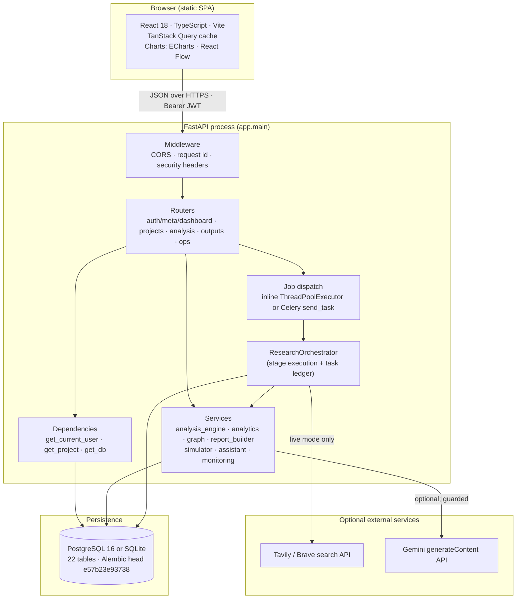
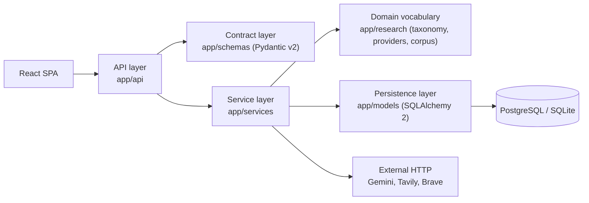
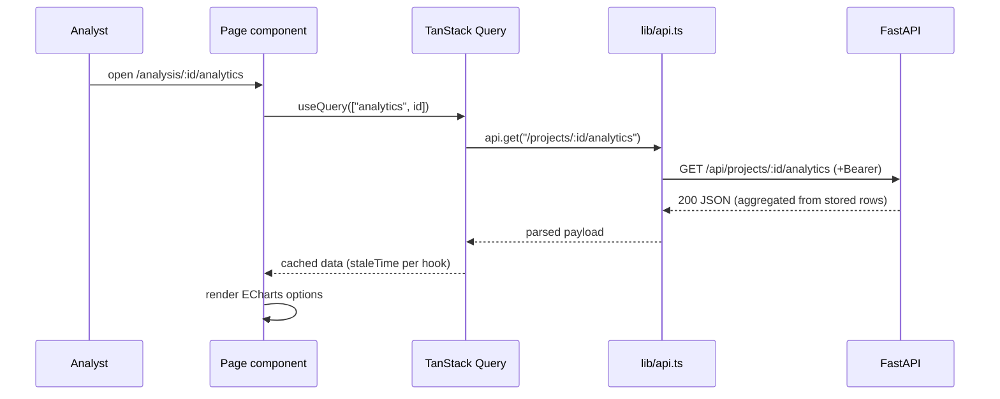
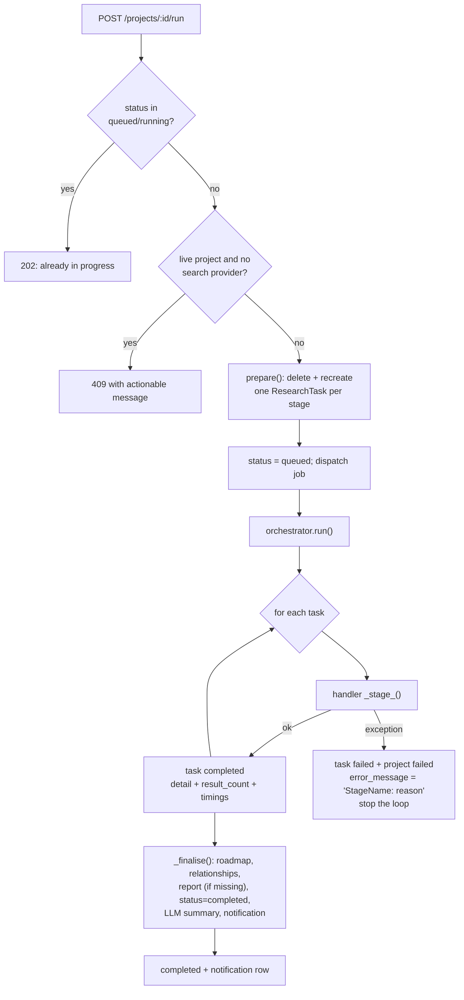
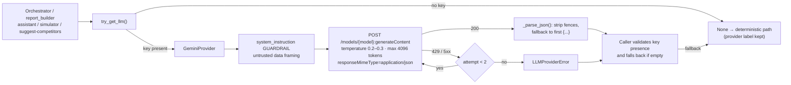
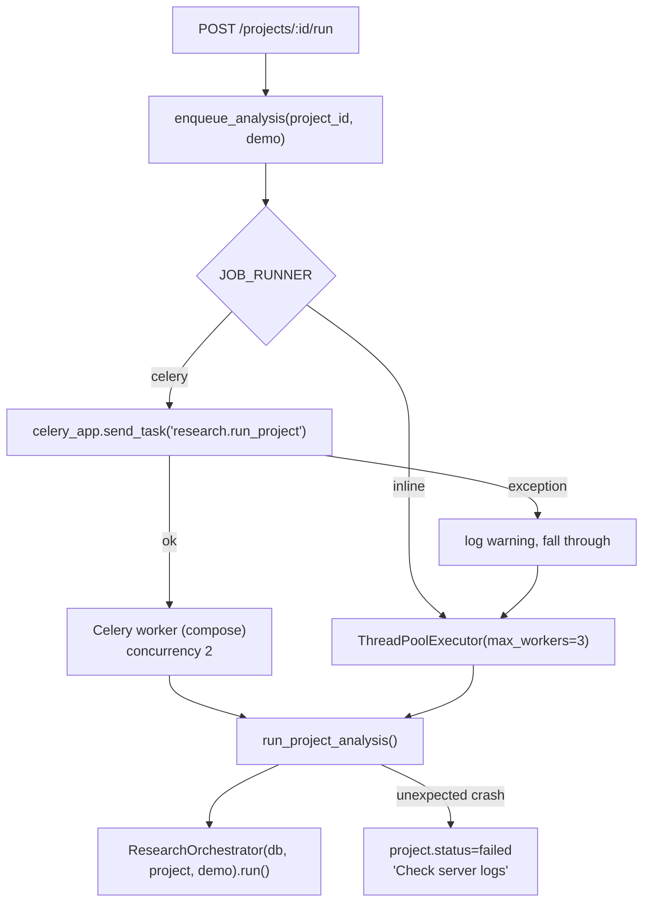
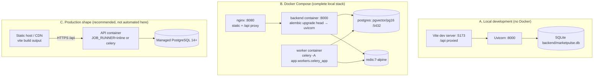
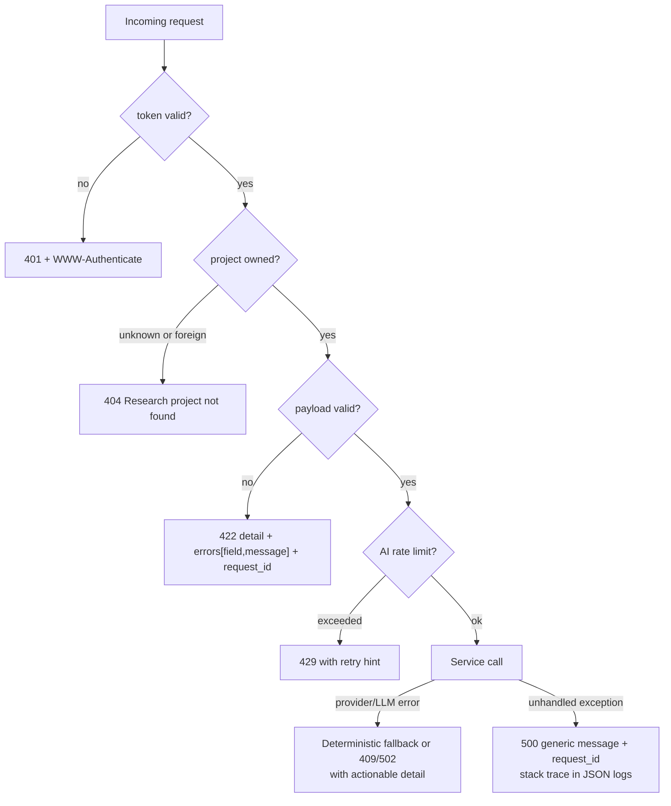

# Architecture

> Scope: how MarketPulse AI is actually built today. Anything not present in the
> repository is marked *not implemented* and linked to
> [`LIMITATIONS_AND_ROADMAP.md`](LIMITATIONS_AND_ROADMAP.md). Diagrams are Mermaid
> and render on GitHub.

---

## 1. System overview

MarketPulse AI is a two-tier application: a React single-page client and a FastAPI
backend that owns all business logic and persistence. There is no server-side
rendering, no message queue requirement, and no third-party identity provider.



**Request-time path** (read): route → dependency (auth + ownership) → query/service
→ Pydantic serialisation.

**Research path** (write): `POST /projects/{id}/run` → job dispatch → orchestrator
stage loop → analysis engine → persisted findings → report.

---

## 2. Architectural style and design principles

| Principle | How it is enforced | Where |
| --- | --- | --- |
| **Layered with thin routes** | Routes validate, resolve the project, call a service, serialise. No business rule or aggregation lives in a router. | `app/api/*.py` |
| **Deterministic core** | Every score, count, severity and aggregate is computed by Python from persisted rows. LLM output is limited to prose fields. | `services/analysis_engine.py`, `services/text_analysis.py` |
| **Evidence as the only source of truth** | Findings are constructed from `EvidenceRecord` rows and keep `evidence_ids`; the assistant refuses to answer with zero evidence (`409`). | `analysis_engine`, `services/assistant.py` |
| **Explicit degradation over silent fallback** | Missing provider → `409` + capability banner. Missing LLM → deterministic output with a provider label. | `core/config.py`, `research/providers.py`, `agents/llm.py` |
| **Observable work** | Each stage is a persisted row with status/timing/counts/error text. | `services/orchestrator.py`, `models/research.py` |
| **Portable persistence** | `Uuid` type and `JSON().with_variant(JSONB, "postgresql")` let the same metadata run on SQLite (dev/test) and PostgreSQL. | `models/base.py` |
| **Ownership by construction** | Project-scoped routes depend on `get_project`, which queries by ID *and* compares `user_id`. | `app/api/deps.py` |
| **Option-free defaults** | `JOB_RUNNER=inline`, `SEARCH_PROVIDER=none`, SQLite — a clone runs with no cloud account. | `core/config.py` |

### Layer map



---

## 3. Frontend architecture

| Concern | Implementation |
| --- | --- |
| Routing | `react-router-dom` 6. `/` landing, `/login`, `/register`, `/dashboard`, `/research/new`, `/monitoring`, and `/analysis/:projectId/*` with 11 child surfaces. Analysis surfaces are `React.lazy`-loaded behind one `<Suspense>` boundary. |
| Server state | TanStack Query 5. Query keys are centralised in `hooks/useProjectData.ts`; the project-status query polls every 1500 ms **only while a run is active**, and mutations invalidate precisely. |
| Session | `AuthProvider` + `ProtectedRoute`. The JWT lives in `localStorage` (`marketpulse-token`); the API client attaches it and clears it on `401`. |
| Forms | React Hook Form + zod (`features/research/schema.ts`), mirrored by backend Pydantic validation — client validation is UX, the server is authoritative. |
| Analysis shell | `pages/analysis/AnalysisLayout.tsx` loads project + status once, renders the stage ledger while running, and exposes both through an outlet context so child pages do not refetch. |
| Charts | One `components/charts/EChart.tsx` wrapper owns instance lifecycle and resize; page code only supplies options. |
| Graph | `@xyflow/react` with typed edges; a node click fetches `GET .../graph/node/{id}/evidence`. |
| Error containment | `ErrorBoundary` at the app root; `ApiError` carries `status`, `detail` and field errors; empty/failed states are explicit components (`Feedback.tsx`). |
| Theming | `ThemeProvider` toggles `html.dark`, persisted under `marketpulse-theme`; design tokens are CSS variables (`styles/index.css`) plus Tailwind scales. |
| Accessibility | Semantic landmarks, labelled inputs, visible focus rings, keyboard-operable tabs/graph, `prefers-reduced-motion` handling. No automated audit has been run. |

### Frontend request flow



---

## 4. Backend architecture

```
backend/app/
├── main.py            FastAPI app, middleware, exception handlers, /health, lifespan
├── api/
│   ├── router.py      mounts the five routers under settings.api_prefix (/api)
│   ├── deps.py        get_current_user, get_project
│   ├── serializers.py project_payload, competitor_payload, project_progress
│   ├── routes_auth.py auth + meta + dashboard
│   ├── routes_projects.py create/list/detail/update/delete/run/status/sources
│   ├── routes_analysis.py evidence/failures/opportunities/customer-voice/
│   │                      competitors/graph/analytics
│   ├── routes_outputs.py report/roadmap/scenarios/chat/export
│   └── routes_ops.py  monitoring, notifications
├── agents/llm.py      LLM provider abstraction + guardrail + JSON parsing
├── core/              config (pydantic-settings), security, logging, ratelimit
├── db/session.py      engine fabrication, SessionLocal, get_db, init_db
├── models/            SQLAlchemy models for 22 tables
├── research/          taxonomy.py, providers.py, demo_corpus.py
├── schemas/           auth.py, project.py, analysis.py
├── services/          orchestrator, analysis_engine, text_analysis, analytics,
│                      graph, report_builder, simulator, assistant, monitoring,
│                      demo_seed
└── workers/           celery_app.py, jobs.py
```

**Startup (`lifespan`)**: configure JSON logging → `init_db()` (create-all for
development) → seed demo workspace when enabled → log the resolved capability
state. Seeding failures are logged and rolled back; they never block startup.

**Middleware order**: `CORSMiddleware` then `RequestContextMiddleware`, which
assigns/propagates `x-request-id`, stores it in a `ContextVar` used by the log
formatter and error envelopes, and appends `x-content-type-options` and
`referrer-policy` to responses.

**Exception handlers**: `StarletteHTTPException` (preserves `WWW-Authenticate`),
`RequestValidationError` → 422 with `{field, message}` list, and a catch-all that
logs the exception with a stack trace and returns a generic message plus
`request_id`.

---

## 5. API layer

- **Versioning**: none. The OpenAPI schema is served at `/openapi.json`, Swagger at
  `/docs`. The client and server ship together, so the contract is the Pydantic
  models.
- **Prefix**: everything except `/health` is mounted under `/api`.
- **Contracts**: request models validate at the edge; response models are declared
  per route (`response_model=`) so the OpenAPI schema is accurate. `ProjectOut`,
  `FailureOut`, `EvidenceOut` and friends use `from_attributes=True`.
- **Static shaping**: `serializers.project_payload` computes `progress` and flattens
  company/config fields that the UI needs on every card.
- **Filtering/pagination is implemented per endpoint, not generically**: evidence
  supports `search`, `source`, `sentiment`, `country`, `date_from`, `date_to`,
  `contradictions_only`, `ids`, `page`, `page_size` (≤ 100); customer voice
  supports a subset plus `topic` and `limit`; project list supports `status` and
  `q`. Everything else returns complete collections — see
  [`PERFORMANCE.md`](PERFORMANCE.md) §3 for what that costs.
- **Full endpoint reference**: [`API_DOCUMENTATION.md`](API_DOCUMENTATION.md).

---

## 6. Service layer

| Module | Responsibility | Determinism |
| --- | --- | --- |
| `analysis_engine.py` | Ingest records (sentiment, topics, credibility, dedupe, corroboration, contradictions, embeddings), build topic clusters, competitors + observations, weaknesses, opportunities, assumption verdicts, strategic relationships, roadmap, report | Fully deterministic |
| `text_analysis.py` | Lexicon sentiment, rating priors, topic keyword matching, key phrases, 5-gram shingles + Jaccard, 96-dim hashing embedding, source credibility prior, truncation | Fully deterministic |
| `analytics.py` | Eight chart datasets + dashboard metrics, aggregated on request from stored rows | Deterministic |
| `graph.py` | Node/edge projection of findings (`complaint`, `expectation`, `weakness`, `competitor`, `trend`, `risk`, `opportunity`, `action`) and node→evidence resolution | Deterministic |
| `report_builder.py` | Versioned report: executive summary, 12 sections, limitations, `reference_ids`, provider label. Reuses allow-listed templates only. | Deterministic (prose may be replaced by Gemini in live mode) |
| `simulator.py` | Qualitative what-if: regex prompt routing (price/market/feature/support), evidence-linked advantages/risks, explicit assumptions, confidence < 1 | Deterministic heuristic; optional Gemini prose in live mode |
| `assistant.py` | Retrieval over the project's evidence, citation assembly, retrieval trace, LLM synthesis or retrieval brief | Retrieval deterministic; prose optional |
| `monitoring.py` | Change summary (new records, positive share, sentiment delta, watches), run recording, next-run arithmetic | Deterministic |
| `demo_seed.py` | Idempotent synthetic workspace (user, company, product, project, config, sources, evidence, findings, report, tasks, monitoring, notification) | Deterministic |
| `orchestrator.py` | Stage execution, task ledger, notifications, finalisation | Deterministic orchestration |

Service functions take `(db: Session, project: ResearchProject, ...)` explicitly —
there is no hidden global state, which is why the engine can be unit-tested against
an in-memory SQLite session (`tests/test_engines.py`).

---

## 7. Research orchestration layer

`ResearchOrchestrator` is the only component that mutates project lifecycle state.



Stage handlers are discovered by name (`getattr(self, f"_stage_{stage}")`), so a
stage listed in the mode profile without a handler reports "Stage not implemented"
and returns 0 items rather than crashing. The current profiles and handlers are
complete for all three modes.

**Audit of stage semantics** (important for interview accuracy): a few stages are
*reporting* stages rather than separate compute steps. `deduplicate`,
`evidence_validation` and `contradiction_analysis` summarise work already performed
at ingest (`ingest()` performs dedupe, credibility scoring, corroboration and
contradiction flagging). They exist so the ledger shows what the pipeline did and
so the analyst gets a readable account; they do not recompute anything.

---

## 8. AI integration layer



Details, prompt inventory and RAG maths: [`AI_ENGINEERING.md`](AI_ENGINEERING.md).

---

## 9. Persistence layer

- SQLAlchemy 2.0 typed declarative models (`Mapped[...]` / `mapped_column`), one
  module per domain: `user`, `research`, `evidence`, `findings`, `reporting`,
  `chat`. `models/__init__.py` registers every mapper.
- `UUIDMixin` (UUID PK, `uuid4` default) and `TimestampMixin` (`created_at`,
  `updated_at` with `server_default=func.now()` and Python-side `onupdate`).
- `SessionLocal` is created with `expire_on_commit=False`, so serialising after
  commit does not re-query.
- Engine options differ by backend: SQLite gets `check_same_thread=False` and
  `PRAGMA foreign_keys=ON` + `journal_mode=WAL`; Postgres gets a pool
  (`pool_size=10`, `max_overflow=20`, `pool_recycle=1800`, `pool_pre_ping=True`).
- Alembic owns schema evolution; `init_db()`/`create_all` exists as a development
  convenience and does **not** substitute for migrations in a deployed database.

Tables, keys, relationships, indexes and deletion behaviour:
[`DATABASE_DESIGN.md`](DATABASE_DESIGN.md).

---

## 10. Background processing



| Property | Inline (default) | Celery (compose) |
| --- | --- | --- |
| External dependencies | none | Redis 7 |
| Concurrency | 3 threads inside the API process | worker concurrency 2 (per worker container) |
| Survives API restart | **no** — in-flight runs are lost | yes (task stays in the broker) |
| Scaling | one API instance | scale workers independently |
| Code path | identical orchestrator entry point | identical |

`workers/celery_app.py` also defines `monitoring.tick`, but **no beat schedule is
configured**, so nothing invokes it automatically (see
[`LIMITATIONS_AND_ROADMAP.md`](LIMITATIONS_AND_ROADMAP.md)).

---

## 11. External integrations

| Integration | Protocol | Auth | Failure behaviour |
| --- | --- | --- | --- |
| Tavily Search | `POST https://api.tavily.com/search`, `search_depth=advanced`, key in body | API key in payload | `ProviderNotConfigured` if unset; `httpx` error → stage fails with `ResearchError` naming the query |
| Brave Search | `GET https://api.search.brave.com/res/v1/web/search` | `X-Subscription-Token` header | as above |
| Google Gemini | `POST {base}/models/{model}:generateContent` | `?key=` query parameter | 429/5xx retried once, then `LLMProviderError`; caller keeps deterministic output |
| PostgreSQL | `psycopg` 3 | URL credentials | health check reports `degraded`; API returns 500 with request id |

No webhook endpoints, outbound queue consumers or third-party SaaS callbacks exist.

---

## 12. Deployment architecture



- A and B are what the repository can run today; C is a deployment shape, not a
  configuration in the repo (there is no Vercel/Render manifest and no
  infrastructure-as-code; `.github/workflows/ci.yml` only runs tests).
- In C, `JOB_RUNNER=inline` is the correct default unless a separate worker process
  is actually paid for; Redis is then unnecessary.
- Compose enforces ordering with health checks (`pg_isready`, `redis-cli ping`,
  `GET /health`, nginx `wget /`) and runs migrations in the backend command.

Details and verification matrix: [`DEPLOYMENT.md`](DEPLOYMENT.md).

---

## 13. Error handling and resilience



| Layer | Strategy |
| --- | --- |
| API | Typed HTTP semantics: `400` invalid semantics, `401` auth, `404` unknown/foreign, `409` conflicting state or missing capability, `422` schema, `429` limit, `500` unhandled, `502` model failure on suggestions |
| Jobs | Stage-level try/except writes `task.detail`, sets project `failed`, stops the loop; the worker wrapper catches anything else and marks the project failed |
| LLM | Two attempts for 429/5xx, JSON parse recovery, caller-side fallback to deterministic output with the original provider label |
| Search | Missing key raises before any request; provider errors abort the stage rather than continuing with partial unknown data |
| Frontend | `ApiError` with status/detail/field errors, `ErrorBoundary`, explicit empty and failure states; 401 clears the stored token and returns the user to sign-in |
| Partial results | Evidence stored before a failure remains queryable; the project shows which stage failed and why |

---

## 14. Architectural trade-offs

| Decision | Benefit | Cost accepted |
| --- | --- | --- |
| Deterministic analysis core + optional LLM | Reproducible, testable, defensible numbers; no prompt can invent severity | Simpler language understanding; sarcasm and novel phrasing are misread |
| Lexical retrieval (hashing embedding + cosine in Python) | Zero dependencies, deterministic, testable, no embedding spend | O(n) scan per question; no semantic generalisation; not a vector database |
| Provider snippets as live record text | No scraping infrastructure, no bot-defence or copyright exposure | Records can be thinner than a full page; extraction quality depends on the provider |
| Inline thread-pool runner by default | `git clone` + `uvicorn` works with no Redis; single-process deployment is viable | In-flight runs are lost on restart; concurrency is per process (3 threads) |
| Single FastAPI service (no BFF, no SSR) | One deployable API, one schema, simple auth | SPA cold start; API base URL is baked in at build time |
| SQLite for tests, PostgreSQL targeted in Docker | Fast, isolated tests with no services | PostgreSQL-specific DDL was not executed in this environment |
| 404 (not 403) for foreign projects | Does not confirm the existence of other users' resources | Slightly unusual semantics; documented explicitly in the API reference |
| In-process rate limiter | No Redis dependency for the default configuration | Per-process, reset on restart, not a security boundary |
| Reports as HTML + print CSS | No headless-browser dependency in the container | Not a generated binary PDF; the user prints/saves |

---

## Related documents

- Data model: [`DATABASE_DESIGN.md`](DATABASE_DESIGN.md)
- Pipeline and algorithms: [`RESEARCH_PIPELINE.md`](RESEARCH_PIPELINE.md)
- AI layer: [`AI_ENGINEERING.md`](AI_ENGINEERING.md)
- Endpoints: [`API_DOCUMENTATION.md`](API_DOCUMENTATION.md)
- Security: [`SECURITY.md`](SECURITY.md)
- Operations: [`DEPLOYMENT.md`](DEPLOYMENT.md) · [`TESTING.md`](TESTING.md) · [`PERFORMANCE.md`](PERFORMANCE.md)
- Decisions: [`decisions/`](decisions/)
