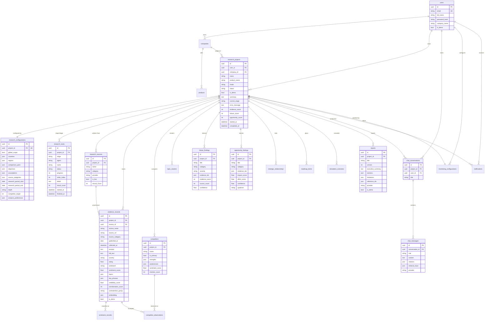
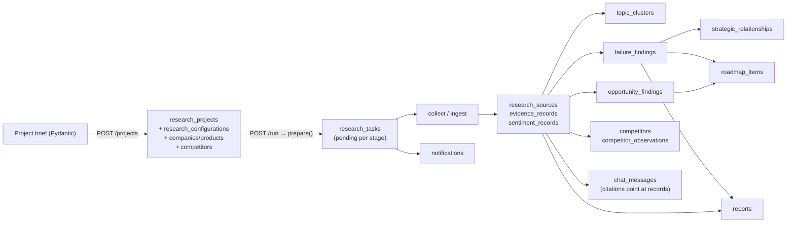

# Database design

> Derived from `backend/app/models/*.py` and the single Alembic revision
> `e57b23e93738` (initial schema). Column names, constraints and indexes below are
> read from the code; nothing here is aspirational.

---

## 1. Database technology

| Aspect | Choice |
| --- | --- |
| Engine (deployed target) | PostgreSQL 14+ (Compose pins `pgvector/pgvector:pg16`) |
| Engine (default local/dev/test) | SQLite (`DATABASE_URL=sqlite:///./marketpulse.db`) |
| ORM | SQLAlchemy 2.0 typed declarative (`Mapped[...]`, `mapped_column`) |
| Migrations | Alembic 1.13, one revision to date |
| Driver | `psycopg` 3 (`postgresql+psycopg://`) |
| Primary keys | UUID (`sqlalchemy.Uuid`, `default=uuid.uuid4`) |
| Timestamps | `created_at`, `updated_at` (`DateTime(timezone=True)`, server default `now()`) |
| Semi-structured data | `JSON` with a PostgreSQL `JSONB` variant (`models/base.py::JSONType`) |
| Extensions enabled on init | `vector`, `uuid-ossp` (`infrastructure/docker/postgres-init.sql`) — `vector` is **not** used by any column or index today |

### Portability decisions

```python
# backend/app/models/base.py
JSONType = JSON().with_variant(JSONB, "postgresql")
```

- One model set runs on both engines, so tests use SQLite and the container uses
  PostgreSQL without divergent schemas.
- Status/severity/label columns are plain `String`, not database enums, so adding a
  value is a code change rather than a migration.
- SQLite connects with `PRAGMA foreign_keys=ON` and `journal_mode=WAL`
  (`db/session.py`), so cascade behaviour in tests matches PostgreSQL more closely
  than SQLite's default.
- Known consequence: `JSON` on SQLite has no containment operators, therefore no
  JSON-path queries exist anywhere in the codebase — arrays are filtered in Python.

---

## 2. Entity overview

22 tables in five domains:

| Domain | Tables |
| --- | --- |
| Identity & company | `users`, `companies`, `products` |
| Research project & configuration | `research_projects`, `research_configurations`, `research_tasks`, `research_sources`, `competitors`, `competitor_observations` |
| Evidence & analysis | `evidence_records`, `sentiment_records`, `topic_clusters` |
| Findings & outputs | `failure_findings`, `opportunity_findings`, `strategic_relationships`, `roadmap_items`, `simulation_scenarios`, `reports` |
| Operations | `chat_conversations`, `chat_messages`, `monitoring_configurations`, `notifications` |

---

## 3. ER diagram



*(Rendered subset shown for readability: the remaining tables —
`products`, `sentiment_records`, `topic_clusters`, `strategic_relationships`,
`roadmap_items`, `simulation_scenarios`, `monitoring_configurations`,
`notifications`, `competitor_observations` — are documented in §4.)*

---

## 4. Table descriptions

### 4.1 Identity

**`users`** — an analyst account.

| Column | Type | Notes |
| --- | --- | --- |
| `id` | UUID PK | |
| `email` | String(320) | **unique**, indexed; stored lower-cased by the API |
| `full_name` | String(160) | not null, default `""` |
| `password_hash` | String(256) | `pbkdf2_sha256$260000$<salt>$<digest>` |
| `company_name` | String(160) | nullable |
| `is_demo` | Boolean | marks the seeded demonstration analyst |

**`companies`** — the subject company of a project; `user_id` → `users.id`
(CASCADE, indexed). Stores name, website, industry, description, target audience,
`is_demo`.

**`products`** — children of a company; `company_id` → `companies.id` (CASCADE,
indexed). One product row is created per project from the brief.

### 4.2 Project and configuration

**`research_projects`** — the aggregate root of the domain.

| Column | Type | Notes |
| --- | --- | --- |
| `user_id` | UUID FK → `users.id` | CASCADE, indexed — **the ownership anchor** |
| `company_id` | UUID FK → `companies.id` | CASCADE, indexed |
| `name`, `product_name` | String | |
| `mode` | String(32) | `quick` \| `standard` \| `deep` |
| `status` | String(24) | `draft` \| `queued` \| `running` \| `completed` \| `failed` \| `cancelled` (tuple `PROJECT_STATUSES`; `cancelled` is declared, never written by current code) |
| `is_demo` | Boolean | indexed |
| `summary`, `current_stage`, `error_message` | Text/String | progress and failure reporting |
| `evidence_count`, `failure_count`, `opportunity_count` | Integer | denormalised counters maintained by the engine |
| `started_at`, `completed_at` | timestamptz | |

**`research_configurations`** — 1:1 with a project (`project_id` **UNIQUE**, CASCADE
in the ORM, no `ondelete` in the migration because the FK is added without cascade
for this table — see §12). Holds `global_scope`, `countries`, `regions`,
`comparison_pairs`, `situation`, `situation_description`, `objectives`,
`assumptions`, `source_categories`, research period, `depth`, `competitor_target`,
`analysis_preferences`, `notes`. JSON arrays keep the brief flexible without extra
tables; they are validated by Pydantic before storage.

**`research_tasks`** — the stage ledger: one row per stage per run, with `stage`,
`agent`, `name`, `status`, `progress`, `order_index`, `detail`, `result_count`,
`started_at`, `finished_at`. Re-running a project deletes and recreates these rows.

**`research_sources`** — provenance summary per source category: `name`,
`category`, `base_url`, `provider` (`demo_dataset` / `search` / provider name),
`is_live`, `record_count`.

**`competitors`** — `is_primary` marks the subject company; the rest are rivals.
`strengths`/`weaknesses` are JSON arrays of taxonomy labels, `mention_count` and
`source_count` are computed from records that name the competitor,
`sentiment_score` is the mean record score, `is_suggested` distinguishes
LLM-suggested names from analyst-entered ones, `positioning`/`pricing_summary`
hold evidence-derived or analyst text.

**`competitor_observations`** — per-dimension observation: `dimension` (topic key
or `pricing`), `value` (truncated example text), `score`, `evidence_id`
(FK → `evidence_records.id`, **ON DELETE SET NULL**, no index), `observed_at`.

### 4.3 Evidence

**`evidence_records`** — the central observation table; every finding points here.

| Column | Notes |
| --- | --- |
| `source_id` | FK → `research_sources.id`, **SET NULL**, indexed |
| `source_name`, `source_url` (1000), `source_category` (indexed) | provenance |
| `published_at` (date, indexed), `collected_at` (timestamptz, not null) | timeline |
| `title` (500), `excerpt` (not null, ≤ 900 chars by `truncate`), `full_text` | content |
| `country` (indexed), `author_handle`, `rating` | segmentation and priors |
| `product_mentioned`, `company_mentioned` | defaults applied at ingest |
| `sentiment` (indexed), `sentiment_score` | label + score in `[-1, 1]` |
| `topics`, `key_phrases` | JSON arrays of taxonomy keys / frequent tokens |
| `credibility_score`, `credibility_label` | deterministic prior |
| `corroboration_count` | records sharing a topic with sufficient n-gram overlap |
| `duplicate_of`, `duplicate_status` | present, currently unused by ingestion (§12) |
| `contradiction_group` | `topic:<key>` when a topic has ≥ 2 negative **and** ≥ 2 positive records |
| `embedding` | JSON array of 96 floats (hashing bag-of-words) |
| `is_demo` (indexed), `external_id`, `search_query` | honesty and provenance |

**`sentiment_records`** — an append-only classification row per ingested record:
`evidence_id` (CASCADE, indexed), `label`, `score`, `confidence`,
`provider` (`lexicon-v1`), `observed_at`. Kept separate from `evidence_records` so
a future classifier can add a second opinion per record without mutating evidence.

**`topic_clusters`** — per topic: `label` (surface form for the cluster kind),
`kind` (`complaint` \| `praise` \| `request` \| `trend`), description, counts
(`evidence_count`, `negative_count`, `positive_count`), `sentiment`, `trend`
(`emerging` \| `declining` \| `stable`), `first_seen`, `last_seen`,
`monthly_counts` (JSON `[{month, count}]`).

### 4.4 Findings and outputs

**`failure_findings`** — one row per topic that crossed the negative-evidence
threshold: `severity` (indexed), `summary`, `observed_complaint` (quote),
`interpretation` (explicitly an interpretation), `business_implications`,
`recommended_actions` (JSON), `evidence_ids` (JSON array of UUID strings),
`evidence_count`, `source_count`, `representative_quote`, `first_observed`,
`last_observed`, `sentiment_score`, `confidence`, `confidence_label`,
`is_observed_complaint`.

**`opportunity_findings`** — `description`, `demand_signal`,
`competitor_comparison`, `strategic_relevance`, `next_action`, `evidence_ids`,
`evidence_count`, `impact_score`, `effort_score`, `confidence`, `quadrant`
(`quick_win` \| `strategic_investment` \| `long_term` \| `low_priority`),
`is_estimate` (true for every generated row — the score is an estimate by
construction).

**`strategic_relationships`** — graph edges: `source_node`, `target_node`
(opaque strings such as `failure:<uuid>`, `risk:<uuid>`, `topic:<uuid>`,
`competitor:<uuid>`, `opportunity:<uuid>`, `action:<uuid>`, `trend:<uuid>`),
`relation` (`surfaces_as`, `creates_risk`, `amplifies`, `opens`, `recommends`),
`rationale`, `confidence`, `evidence_ids`. Node identity is a string prefix rather
than a FK so a single edge table can join heterogeneous node types — the trade-off
is referential integrity enforced in application code (`graph.py` filters edges
whose endpoints are not in the node set).

**`roadmap_items`** — `finding_type` (`failure` \| `opportunity`) + `finding_id`
(UUID **without** an FK, polymorphic by `finding_type`), `title`, `problem`,
`improvement`, `expected_impact`, `complexity`, `priority`, `horizon`
(`immediate` \| `short_term` \| `medium_term` \| `long_term`), `confidence`,
`success_metrics` (JSON), `status` (`planned` \| `in_progress` \| `completed` \|
`parked`), `notes`, `order_index`.

**`simulation_scenarios`** — `name`, `prompt`, `assumptions`, `advantages`,
`disadvantages`, `competitor_responses`, `risks`, `evidence_ids`, `confidence`,
`provider` (`heuristic-v1` or `gemini-v1`). Also carries a nullable
`created_at_index` column that duplicates `created_at` and is never written — a
vestigial column from the initial revision (§12).

**`reports`** — versioned documents: `version` (max+1 per project), `title`,
`executive_summary`, `sections` (JSON list of typed sections),
`limitations` (JSON), `reference_ids` (JSON, up to 40 record IDs), `generated_at`,
`provider` (`template-v1`, `demo-dataset+heuristic-v1`, `gemini+template-v1`, …),
`is_demo`. Old versions are retained; the API returns the highest version.

### 4.5 Operations

**`chat_conversations`** — one per (project, user) pair by convention
(`get_or_create_conversation` selects the oldest), `title`.

**`chat_messages`** — `role` (`user` \| `assistant`), `content`, `citations` (JSON
list of record summaries), `retrieval_trace` (JSON list of steps), `provider`
(`user`, `retrieval-v1`, `gemini-rag-v1`).

**`monitoring_configurations`** — 1:1 with project (`project_id` UNIQUE) and also
`user_id` (CASCADE, indexed): `enabled`, `interval`
(`daily` \| `weekly` \| `fortnightly` \| `monthly`), `track` (JSON list),
`last_run_at`, `next_run_at`, `execution_mode` (`manual` \| `automated`).

**`notifications`** — `user_id` (indexed), `project_id` (nullable, indexed), `kind`
(`demo_ready`, `research_completed`, `research_failed`, `monitoring_run`, `info`),
`title`, `body`, `read`, `action_route` (frontend path).

---

## 5. Primary keys

Every table uses a UUID primary key (`UUIDMixin`), generated application-side with
`uuid.uuid4`. Consequences:

- IDs are safe to expose in URLs (no enumeration) — consistent with returning 404
  for foreign projects.
- `evidence_ids` JSON arrays can store IDs directly and be compared as strings.
- UUIDs are stored as native `uuid` on PostgreSQL and as 32-char text on SQLite via
  SQLAlchemy's `Uuid` type.

---

## 6. Foreign keys and relationships

| Child | Column | Parent | On delete | Indexed |
| --- | --- | --- | --- | --- |
| `companies` | `user_id` | `users.id` | CASCADE | ✔ |
| `products` | `company_id` | `companies.id` | CASCADE | ✔ |
| `research_projects` | `user_id` | `users.id` | CASCADE | ✔ |
| `research_projects` | `company_id` | `companies.id` | CASCADE | ✔ |
| `research_configurations` | `project_id` | `research_projects.id` | CASCADE (ORM) / no cascade in migration | UNIQUE |
| `research_tasks` | `project_id` | `research_projects.id` | CASCADE | ✔ |
| `research_sources` | `project_id` | `research_projects.id` | CASCADE | ✔ |
| `competitors` | `project_id` | `research_projects.id` | CASCADE | ✔ |
| `competitor_observations` | `competitor_id` | `competitors.id` | CASCADE | ✔ |
| `competitor_observations` | `evidence_id` | `evidence_records.id` | SET NULL | ✘ |
| `evidence_records` | `project_id` | `research_projects.id` | CASCADE | ✔ |
| `evidence_records` | `source_id` | `research_sources.id` | SET NULL | ✔ |
| `sentiment_records` | `project_id` | `research_projects.id` | CASCADE | ✔ |
| `sentiment_records` | `evidence_id` | `evidence_records.id` | CASCADE | ✔ |
| `topic_clusters` | `project_id` | `research_projects.id` | CASCADE | ✔ |
| `failure_findings` | `project_id` | `research_projects.id` | CASCADE | ✔ |
| `opportunity_findings` | `project_id` | `research_projects.id` | CASCADE | ✔ |
| `strategic_relationships` | `project_id` | `research_projects.id` | CASCADE | ✔ |
| `roadmap_items` | `project_id` | `research_projects.id` | CASCADE | ✔ |
| `simulation_scenarios` | `project_id` | `research_projects.id` | CASCADE | ✔ |
| `reports` | `project_id` | `research_projects.id` | CASCADE | ✔ |
| `monitoring_configurations` | `project_id` | `research_projects.id` | CASCADE | UNIQUE |
| `monitoring_configurations` | `user_id` | `users.id` | CASCADE | ✔ |
| `notifications` | `user_id` | `users.id` | CASCADE | ✔ |
| `notifications` | `project_id` | `research_projects.id` | CASCADE | ✔ |
| `chat_conversations` | `project_id` / `user_id` | `research_projects.id` / `users.id` | CASCADE | ✔ / ✔ |
| `chat_messages` | `conversation_id` | `chat_conversations.id` | CASCADE | ✔ |

Deliberate non-FKs: `evidence_records.duplicate_of`, `roadmap_items.finding_id`,
and the node strings in `strategic_relationships`. These are documented
integrity gaps, not oversights — see §12.

---

## 7. Unique constraints

| Constraint | Table | Purpose |
| --- | --- | --- |
| `uq users.email` (unique index) | `users` | one account per address; duplicate registration returns 409 |
| `UNIQUE(project_id)` | `research_configurations` | one configuration per project |
| `UNIQUE(project_id)` | `monitoring_configurations` | one monitor per project |

There is **no** uniqueness constraint on evidence URLs. Duplicate suppression is
application-level (5-gram Jaccard ≥ 0.72) — deliberate, because the same URL can
legitimately appear across projects and because the canonical-URL rule was never
implemented (§12).

---

## 8. Indexing strategy

All indexes come from the initial migration; there are no composite, partial or
expression indexes.

| Pattern | Columns |
| --- | --- |
| Ownership lookups | `research_projects.user_id`, `companies.user_id`, `notifications.user_id`, `monitoring_configurations.user_id`, `chat_conversations.user_id` |
| Aggregate-root scoping | `project_id` on every project-scoped table |
| Lifecycle filtering | `research_projects.status`, `research_projects.is_demo`, `failure_findings.severity` |
| Evidence filtering | `evidence_records.source_category`, `.country`, `.sentiment`, `.published_at`, `.is_demo`, `.source_id` |
| Join paths | `competitor_observations.competitor_id`, `sentiment_records.evidence_id`, `chat_messages.conversation_id` |

What this does **not** cover (measured implications in
[`PERFORMANCE.md`](PERFORMANCE.md)): evidence text search is a Python substring
scan over all project records, and there is no index supporting the JSON `topics`
array. Ordering by `published_at DESC NULLS LAST` can use the single-column index
but has no covering composite with `project_id`.

---

## 9. JSON / JSONB usage

| Column | Shape | Why JSON |
| --- | --- | --- |
| `research_configurations.countries`, `.regions`, `.comparison_pairs`, `.objectives`, `.assumptions`, `.source_categories`, `.analysis_preferences` | string arrays; assumptions become `{text, status, rationale, support_count, contradict_count, evidence_ids, topics}` | brief-shaped, variable, never joined |
| `evidence_records.topics`, `.key_phrases`, `.embedding` | string arrays; 96 floats | per-record tags; retrieval works in Python |
| `topic_clusters.monthly_counts` | `[{month, count}]` | chart-ready series |
| `failure_findings.evidence_ids`, `.recommended_actions` | UUID strings; strings | ordered references, no join required |
| `opportunity_findings.evidence_ids` | UUID strings | as above |
| `strategic_relationships.evidence_ids` | UUID strings | as above |
| `reports.sections`, `.limitations`, `.reference_ids` | typed section objects | document structure versioned per report |
| `chat_messages.citations`, `.retrieval_trace` | objects | audit trail of an answer |
| `monitoring_configurations.track` | string array | user-selected watches |
| `simulation_scenarios.assumptions`, `.advantages`, … | string arrays | qualitative model output |

Rules observed throughout: JSON holds **lists of scalars or small display objects**
that are read-write as a unit; anything filtered or joined is a real column. Because
`JSONType` degrades to `JSON` on SQLite, no query depends on JSON operators.

---

## 10. Migration strategy

```
backend/migrations/
├── env.py
├── script.py.mako
└── versions/e57b23e93738_initial_schema.py   (down_revision = None)
```

- `env.py` imports `settings` and resolves `DATABASE_URL` from application settings
  rather than `alembic.ini`, so the CLI, the container command and the app share one
  source of truth. `prepend_sys_path = .` makes `app.*` importable.
- DDL is generated in `batch_alter_table` blocks, which keeps the script portable
  for SQLite (no `ALTER` support) as well as PostgreSQL.
- Column types use `sa.Uuid()` and
  `sa.JSON().with_variant(postgresql.JSONB(astext_type=Text()), 'postgresql')`, so
  the same revision produces native UUID/JSONB on PostgreSQL.
- The initial revision creates all 22 tables with their indexes and constraints and
  is the only revision; there is no migration-branching, no data migration and no
  downgrade test beyond the single revision's `downgrade()`.
- Workflow: `alembic upgrade head` (compose backend command and README), confirm with
  `alembic current`, roll back one step with `alembic downgrade -1`.
- Adding a model field today requires a new revision (`alembic revision --autogenerate`)
  — `create_all()` in `init_db()` only helps a fresh SQLite file and never alters an
  existing table.

Verified in this environment on SQLite only. PostgreSQL execution is *not verified*
(no Docker daemon available) — see [`DEPLOYMENT.md`](DEPLOYMENT.md) §9.

---

## 11. Data ownership and isolation

| Level | Mechanism |
| --- | --- |
| Authentication | JWT `sub` = user UUID; `get_current_user` loads the row and 401s if the user no longer exists |
| Project ownership | `get_project(project_id)` compares `project.user_id` with the authenticated user and returns **404** otherwise |
| Query scoping | Project-scoped queries are made through the resolved `project`; listing endpoints filter on `ResearchProject.user_id == user.id` |
| Conversation ownership | `chat_conversations.user_id` is set from the authenticated user; history queries filter on both `project_id` and `user_id` |
| Notification ownership | `GET /notifications` and `mark_read` filter/compare `user_id` |
| Roadmap/scenario mutation | The row is loaded then compared with the resolved `project.id`; mismatch → 404 |
| Evidence of isolation | `tests/test_project_flow.py::test_project_isolation_between_users` asserts 404 on detail/evidence and an empty list for a second user |

What isolation does **not** provide: there is no row-level security in the database,
no organisation/team tenancy above the user, and no sharing model. A user is the
tenant.

---

## 12. Cascading, deletion and integrity

**Delete a project** (`DELETE /projects/{id}`) — `db.delete(project)` plus ORM
`cascade="all, delete-orphan"` on every child relationship removes: configuration,
tasks, sources, competitors (+ observations), evidence (+ sentiment records),
topic clusters, failures, opportunities, relationships, roadmap items, scenarios,
reports, conversations (+ messages), monitoring configuration and notifications.
`test_delete_project_removes_children` asserts the project 404s afterwards.

**Delete a user** — there is no endpoint, but the FK graph is CASCADE from `users`
for companies, projects, conversations, notifications and monitoring. Companies and
projects also cascade onward, so a user delete is a complete purge at the database
level.

**Delete an evidence row** — not exposed. If it happens out of band:
`competitor_observations.evidence_id` becomes NULL (SET NULL), `sentiment_records`
cascade, and `evidence_ids` JSON arrays in findings keep dangling UUIDs. This is the
main integrity cost of storing references in JSON instead of a join table.

**Deleting a source** — `evidence_records.source_id` becomes NULL; `source_name` and
`source_url` remain, so provenance survives.

**Known integrity gaps** (documented, not fixed in this pass):

1. `research_configurations.project_id` relies on ORM cascade; the migration creates
   the FK without `ondelete='CASCADE'`, so a raw SQL project delete would fail on that
   child row instead of cascading it.
2. `evidence_records.duplicate_of` and `roadmap_items.finding_id` have no FK; they are
   application-maintained references.
3. `strategic_relationships` endpoints are strings; `graph.py` drops edges whose
   endpoints are missing from the projected node set rather than failing.
4. `evidence_records.duplicate_status` is always `"unique"` in practice: ingestion
   skips near-duplicates instead of storing them, so `duplicate_of` is never written.
5. `simulation_scenarios.created_at_index` is unused.
6. `research_projects.status` accepts `cancelled` by declaration only; no route sets
   it.

---

## 13. How data moves through the persistence layer



Reads are always derived at request time from these rows: `analytics.py`, `graph.py`
and `report_builder.py` compute their views on demand rather than storing snapshots
(except `reports`, which is a deliberate versioned artefact).

---

## 14. Useful queries

Inspect the evidence behind one project (read-only, no sensitive data):

```sql
SELECT source_category, sentiment, COUNT(*) AS records
FROM evidence_records
WHERE project_id = :project_id
GROUP BY source_category, sentiment
ORDER BY records DESC;
```

Severity distribution and confidence for a project:

```sql
SELECT severity, COUNT(*) AS findings, ROUND(AVG(confidence), 2) AS avg_confidence
FROM failure_findings
WHERE project_id = :project_id
GROUP BY severity
ORDER BY CASE severity
           WHEN 'critical' THEN 1 WHEN 'high' THEN 2
           WHEN 'medium' THEN 3 ELSE 4 END;
```

Stage timings from the ledger (the pipeline observability view):

```sql
SELECT stage, status, result_count,
       EXTRACT(EPOCH FROM (finished_at - started_at)) AS seconds
FROM research_tasks
WHERE project_id = :project_id
ORDER BY order_index;
```

Contradiction review — topics with records on both sides:

```sql
SELECT contradiction_group, sentiment, COUNT(*)
FROM evidence_records
WHERE project_id = :project_id AND contradiction_group IS NOT NULL
GROUP BY contradiction_group, sentiment
ORDER BY contradiction_group;
```

---

## Related documents

- Schema rationale and trade-offs: [`ARCHITECTURE.md`](ARCHITECTURE.md) §9
- How rows are produced: [`RESEARCH_PIPELINE.md`](RESEARCH_PIPELINE.md)
- Migration commands: [`DEPLOYMENT.md`](DEPLOYMENT.md) §4
- Aggregation cost: [`PERFORMANCE.md`](PERFORMANCE.md) §2
