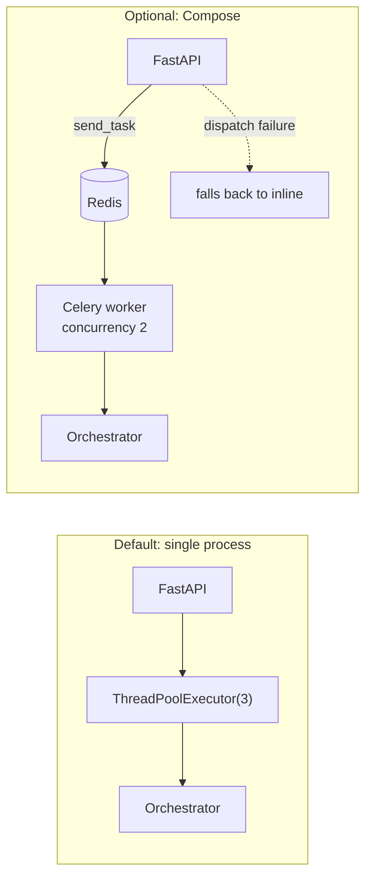

# Deployment and infrastructure

> Three distinct configurations exist in this repository: **A** local bare-metal
> development, **B** the complete Docker Compose stack, and **C** a split production
> shape that is *recommended but not implemented as automation*. They differ in
> database, job runner, and whether Redis/Celery exist. Do not conflate them.

---

## 1. Comparison

| | A. Local (no Docker) | B. Docker Compose | C. Production shape (recommended) |
| --- | --- | --- | --- |
| Frontend | Vite dev server `:5173` | nginx `:8080`, static `dist/` | Static host / CDN from `vite build` |
| API | Uvicorn `:8000 --reload` | `backend` container `:8000` | One API container/instance |
| Database | SQLite file | `postgres` (pgvector/pg16) | Managed PostgreSQL 14+ |
| Job runner | `inline` (default) | `celery` (worker container) | `inline` unless a worker is deployed |
| Redis | not used | `redis:7-alpine` (broker/result) | only if Celery is used |
| Migrations | manual `alembic upgrade head` | automatic in the backend command | release step before the new image serves |
| TLS | none | none (nginx serves HTTP) | terminated in front (LB/proxy) |
| Logs | stdout | `docker compose logs` | platform log driver |
| Verified here | yes | **no** (no Docker daemon available) | n/a (no deployment exists) |

---

## 2. A — Local development

```bash
cp .env.example .env                 # edit SECRET_KEY
python -m venv .venv && source .venv/bin/activate
pip install -r backend/requirements.txt

cd backend
alembic upgrade head
uvicorn app.main:app --reload --port 8000

cd ../frontend && npm install && npm run dev        # http://127.0.0.1:5173
```

- Vite proxies `/api` → `VITE_PROXY_TARGET` (default `http://127.0.0.1:8000`), so the
  browser sees one origin in development.
- SQLite is configured with WAL and `foreign_keys=ON`; the file lives at
  `backend/marketpulse.db` and is git-ignored.
- The API seeds the demo workspace on startup when `DEMO_MODE` and
  `SEED_DEMO_ON_STARTUP` are true.
- `make dev-backend`, `make dev-frontend`, `make migrate`, `make seed`,
  `make test` wrap the same commands (the Makefile uses `python`, which on Windows may
  need the venv's interpreter on `PATH`).

---

## 3. B — Docker Compose stack

```bash
cp .env.example .env
# set SECRET_KEY (32+ random chars) and POSTGRES_PASSWORD before exposing anything
docker compose up --build -d
docker compose ps
docker compose logs -f backend
```

| Service | Image / build | Role | Health check | Ports |
| --- | --- | --- | --- | --- |
| `postgres` | `pgvector/pgvector:pg16` | database; init script enables `vector` + `uuid-ossp` | `pg_isready -U $POSTGRES_USER -d $POSTGRES_DB` | `5432:5432` |
| `redis` | `redis:7-alpine` | Celery broker/result backend, AOF on | `redis-cli ping` | internal |
| `backend` | `backend/Dockerfile` (python:3.12-slim, non-root `appuser`, uid 10001) | runs `alembic upgrade head` then uvicorn with `--proxy-headers` | `curl -fsS /health` | `8000:8000` |
| `worker` | same image | `celery -A app.workers.celery_app.celery_app worker --loglevel=info --concurrency=2` | none | — |
| `frontend` | `frontend/Dockerfile` (node:20-alpine build → nginx:1.27-alpine) | static app + `/api` reverse proxy | `wget -qO- /` | `8080:80` |

Ordering: `backend` waits for healthy `postgres` **and** `redis`; `worker` waits for
both plus a started backend; `frontend` waits for a healthy backend.

Frontend build args: `VITE_API_BASE_URL=/api` (relative) so the SPA calls nginx on the
same origin, which proxies to `http://backend:8000/api/`.

`frontend/nginx.conf` also sets gzip for text assets, a 7-day cache for hashed
static files, `client_max_body_size 4m`, `proxy_read_timeout 120s` and
`X-Frame-Options: SAMEORIGIN`.

Volumes: `pgdata`, `redisdata`. Back up `pgdata` — it holds accounts, evidence and
reports:

```bash
docker compose exec postgres pg_dump -U marketpulse marketpulse > backup.sql
```

---

## 4. Database migrations

```bash
cd backend
alembic upgrade head      # apply
alembic current           # inspect the applied revision
alembic downgrade -1      # roll back one revision
```

- `migrations/env.py` reads `DATABASE_URL` from `app.core.config.settings`, not from
  `alembic.ini`, so the CLI, the container command and the app share one value.
- The Compose backend runs `alembic upgrade head` on every start (idempotent).
- On a platform without a release phase, run it as a one-off job against the same
  `DATABASE_URL` before switching traffic.
- The repository has exactly one revision (`e57b23e93738`, initial schema). It was
  exercised with upgrade and downgrade **against SQLite only**.
- `init_db()` (`Base.metadata.create_all`) also runs at startup as a development
  convenience; it does not migrate existing tables, so never rely on it in a deployed
  environment.

---

## 5. Build process

| Artifact | Command | Output |
| --- | --- | --- |
| Frontend bundle | `cd frontend && npm run build` (`tsc -b && vite build`) | `frontend/dist/` (sourcemaps off) |
| Backend image | `docker build -t marketpulse-api ./backend` | runs `uvicorn app.main:app` as uid 10001 |
| Frontend image | `docker build --build-arg VITE_API_BASE_URL=/api -t marketpulse-web ./frontend` | nginx + static files |

`VITE_API_BASE_URL` is compiled into the bundle at build time; changing the API origin
requires a rebuild, not a restart.

---

## 6. Environment variables

Every variable is read by `backend/app/core/config.py` (pydantic-settings, `.env` or
`../.env`). Defaults below are the code defaults.

| Variable | Default | Effect |
| --- | --- | --- |
| `ENVIRONMENT` | `development` | `development` \| `test` \| `production`; sets log level (DEBUG in development) and is echoed by `/health` |
| `SECRET_KEY` | `dev-insecure-secret-change-me-please-0123456789` | JWT signing key — **must** be changed |
| `ACCESS_TOKEN_EXPIRE_MINUTES` | `10080` | token lifetime (7 days) |
| `DATABASE_URL` | `sqlite:///./marketpulse.db` | SQLAlchemy URL; Compose injects `postgresql+psycopg://…@postgres:5432/…` |
| `CORS_ORIGINS` | `http://localhost:5173,http://localhost:8080` | comma-separated allowlist |
| `DEMO_MODE` | `true` | enables `/auth/demo`, demo seeding, demo credentials in `/meta/capabilities` |
| `SEED_DEMO_ON_STARTUP` | `true` | seed the demo workspace at startup (idempotent) |
| `SEARCH_PROVIDER` | `none` | `none` \| `tavily` \| `brave` — live research requires a configured provider |
| `TAVILY_API_KEY` / `BRAVE_API_KEY` | empty | provider credentials |
| `SEARCH_TIMEOUT_SECONDS` | `25` | provider HTTP timeout |
| `LLM_PROVIDER` | `gemini` | `gemini` \| `none` |
| `GEMINI_API_KEY` | empty | enables LLM enrichment when set |
| `GEMINI_MODEL` | `gemini-2.0-flash` | model id |
| `GEMINI_API_BASE` | `https://generativelanguage.googleapis.com/v1beta` | API base |
| `LLM_TIMEOUT_SECONDS` | `60` | model HTTP timeout |
| `JOB_RUNNER` | `inline` | `inline` (thread pool) \| `celery` (Redis) |
| `REDIS_URL` | `redis://localhost:6379/0` | broker/result backend when `JOB_RUNNER=celery` |
| `RATE_LIMIT_AI_PER_HOUR` | `60` | per-user hourly budget for AI endpoints |
| `RESEARCH_MAX_QUERIES` | `12` | **declared but unused** — mode profiles govern query counts |
| `MAX_UPLOAD_BYTES` | `2000000` | **declared but unused** — no upload endpoint exists |
| `VITE_API_BASE_URL` | `/api` (Compose build arg) | frontend API base, baked at build time |
| `VITE_PROXY_TARGET` | `http://127.0.0.1:8000` | Vite dev proxy target |
| `E2E_BASE_URL` | — | Playwright base URL when not using its `webServer` |

Compose additionally consumes `POSTGRES_USER`, `POSTGRES_PASSWORD`, `POSTGRES_DB`
(defaults `marketpulse`/`marketpulse`/`marketpulse` — development values).

Never commit `.env`. In production, set these in the platform's secret manager.

---

## 7. Before exposing any environment

1. `SECRET_KEY` rotated to 32+ random characters (the app will happily start with the
   default, so check `/health` and your env source).
2. `CORS_ORIGINS` restricted to the real origins.
3. `ENVIRONMENT=production`; decide on `DEMO_MODE`/`SEED_DEMO_ON_STARTUP` — the shared
   demo account must be **disabled** (`DEMO_MODE=false`) or its password changed.
4. TLS terminated in front of nginx/the API (the containers serve plain HTTP).
5. `POSTGRES_PASSWORD` set and port 5432 unpublished.
6. Provider keys stored as secrets, not in an env file in git.
7. Backups scheduled and a restore actually tested.
8. `RATE_LIMIT_AI_PER_HOUR` tuned to expected assistant usage.
9. Images rebuilt for base-image security updates (no automated scanning exists).

---

## 8. Redis and Celery: local vs deployed

This is the most commonly misread part of the project. **Redis and Celery are
optional, and the deployed-intended default is the inline runner.**

| Question | Answer |
| --- | --- |
| What runs locally (no Docker)? | Inline runner in the API process, `ThreadPoolExecutor(max_workers=3)`. No Redis. |
| What runs in Compose? | Celery worker over Redis (`JOB_RUNNER=celery` for both backend and worker services). |
| What does a single-container deployment use? | `JOB_RUNNER=inline`. Redis is unnecessary and should not be provisioned. |
| Does production *use* Celery? | Nothing in the repository deploys anything; if you deploy without a worker, production uses the inline runner. |
| What changes when background services are unavailable? | Research still runs (in-process). Differences: concurrency is 3 threads per API process; an API restart loses in-flight runs; there is no separate worker pool to scale; `monitoring.tick` cannot be scheduled. |
| Is scheduling automated anywhere? | No. `monitoring.tick` exists as a Celery task but no beat schedule is configured, and monitoring reports `execution_mode: manual` without a live provider. |



Trade-off summary: the inline runner keeps the deployment cheap and simple and is
adequate for analyst-driven, one-run-at-a-time usage. Celery buys durability across
restarts and independent scaling at the cost of Redis, a second process and its
operational surface.

---

## 9. What was verified here

| Check | Result |
| --- | --- |
| `pytest -q` (SQLite, in-memory/isolated files) | **23 passed** |
| Alembic revision present and importable | yes (`e57b23e93738`) |
| Alembic upgrade against SQLite (previous runs, recorded in project docs) | passed |
| Alembic upgrade/downgrade against **PostgreSQL** | **not executed** — no Docker daemon on this machine |
| `npm test` | **8 files / 30 tests passed** |
| `npm run build` | passed |
| Playwright journey | recorded in [`TESTING.md`](TESTING.md) |
| `docker compose up --build` | **not executed** (Docker unavailable) |
| Backend + Vite running together on this machine | verified (`/health` 200, SPA 200, live API calls from the UI) |
| Live Tavily/Brave/Gemini calls | **not exercised** — no provider keys were used; only fallback paths are covered by tests |
| Managed Postgres / Redis providers | **not executed** |

The Dockerfiles, Compose file, nginx configuration and health checks are therefore
*provided as written and reviewed*, not *proven to boot*. Validate them on a Docker
host before quoting them as working.

---

## 10. Observability and operations

| Concern | Implementation |
| --- | --- |
| Logs | JSON lines on stdout (`ts, level, logger, request_id, message, event, project_id, user_id, stage, duration_ms, exception`), collected by the platform |
| Request correlation | `x-request-id` in/out, also included in error bodies |
| Liveness | `GET /health` → `status`/`database`/`demo_mode`/`live_research_available`/`job_runner`/`environment`; returns 200 even when degraded |
| Pipeline diagnosis | `research_tasks` rows (status, timings, counts, error text) surfaced by `GET /projects/{id}/status` and the UI |
| Restart behaviour | Compose `restart: unless-stopped` for all services; backend re-runs migrations on start; in-flight inline jobs are lost (no reconciler marks them failed) |
| Demo seeding | idempotent (`seed_demo_workspace` returns early when a demo project exists); also runnable via `python -m scripts.seed_demo` |
| Metrics/tracing | **not implemented** — no Prometheus endpoint, no OpenTelemetry, no APM integration |
| Alerts | **not implemented** |

---

## 11. Cost and free-tier reality

- Demo mode needs **no** paid keys: the seeded workspace is synthetic and analysis is
  deterministic.
- Live research consumes provider credits (Tavily/Brave) and Gemini quota per run; a
  `deep` run can issue up to 14 searches and several model calls.
- Free tiers on common hosts sleep after inactivity (30–60 s cold starts), cap monthly
  hours, expire managed databases, or limit Redis connections. A permanently free,
  always-on deployment is not guaranteed by any provider.
- The cheapest coherent deployment is a single small always-on container with
  `JOB_RUNNER=inline` plus a free-tier managed PostgreSQL.

---

## Related documents

- Architecture diagrams per environment: [`ARCHITECTURE.md`](ARCHITECTURE.md) §12
- Schema and migrations: [`DATABASE_DESIGN.md`](DATABASE_DESIGN.md) §10
- Hardening controls: [`SECURITY.md`](SECURITY.md) §10, §15
- Known deployment limitations: [`LIMITATIONS_AND_ROADMAP.md`](LIMITATIONS_AND_ROADMAP.md) §2
