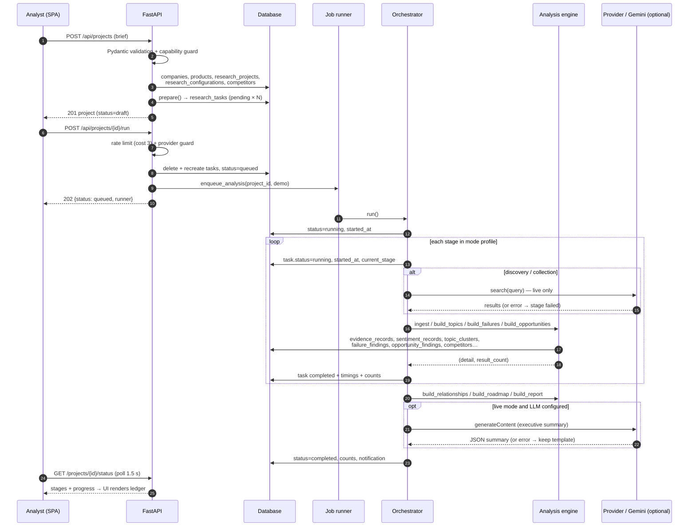
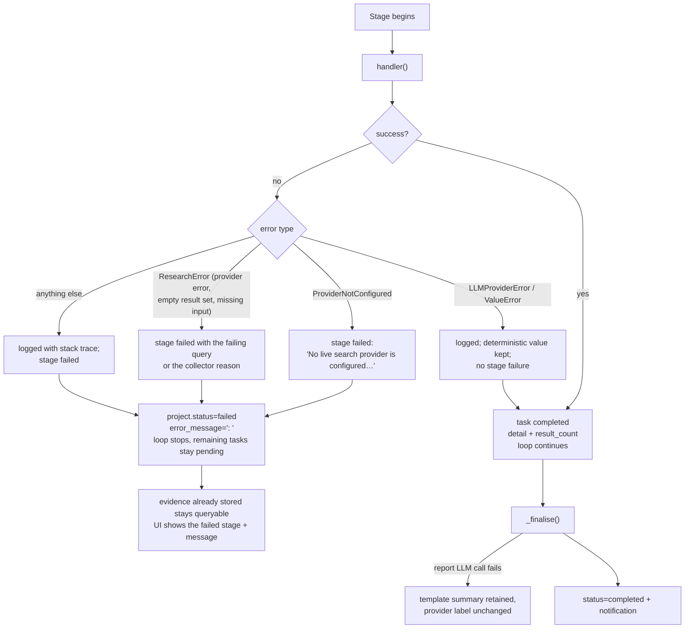

# Research pipeline

> Everything below is implemented in `backend/app/services/orchestrator.py`,
> `backend/app/services/analysis_engine.py` and
> `backend/app/services/text_analysis.py`. Where an expected stage is **not**
> implemented, it says so explicitly and links to
> [`LIMITATIONS_AND_ROADMAP.md`](LIMITATIONS_AND_ROADMAP.md). Nothing here is a
> plan.

---

## 1. Design principles

1. **Collect, then derive, then interpret.** A finding is only created from stored
   records. `FailureFinding.evidence_ids` and
   `OpportunityFinding.evidence_ids` are populated from real rows; a topic with no
   negative records produces no finding at all.
2. **Every stage is observable.** One `research_tasks` row per stage with `status`,
   `started_at`, `finished_at`, `result_count`, `detail` and error text. The UI polls
   `GET /projects/{id}/status` every 1.5 s while a run is active.
3. **Deterministic where it matters.** Sentiment, topics, severity, confidence,
   impact/effort, roadmap sequencing and aggregates are computed by code with
   documented thresholds. The LLM never writes a number.
4. **Fail loudly, degrade visibly.** Missing provider → `409` before any job runs.
   Stage exception → task `failed`, project `failed`, message surfaced in the UI.
   Missing LLM → deterministic output with a provider label that says so.

---

## 2. Modes and stage lists

From `research/taxonomy.py::MODE_PROFILES` (served by `GET /api/meta/catalog`):

| Mode | Label | Stages | Query budget | Evidence target | Max competitors | Capabilities |
| --- | --- | --- | --- | --- | --- | --- |
| `quick` | Quick Scan | 10 | 4 | 14 | 2 | sentiment, topics, failures |
| `standard` | Standard Analysis | 15 | 8 | 32 | 3 | + opportunities, competitors |
| `deep` | Deep Intelligence | 18 | 14 | 44 | 4 | + trends, contradictions, roadmap |

`quick` stages: `understand_request`, `generate_questions`, `discover_sources`,
`collect_results`, `extract_evidence`, `deduplicate`, `sentiment_classification`,
`complaint_detection`, `evidence_validation`, `business_conclusions`.

`standard` adds: `entity_linking`, `opportunity_detection`,
`competitor_positioning`, `chart_datasets`, `executive_report`.

`deep` adds: `trend_modelling`, `contradiction_analysis`, `roadmap_generation`.

---

## 3. Pipeline overview

```mermaid
flowchart TD
    A["1. Brief validated<br/>(Pydantic: ISO countries, source categories,<br/>period order, length limits)"] --> B["2. Project + configuration + company/product<br/>+ competitors persisted; status=draft"]
    B --> C["3. prepare(): one research_tasks row per stage<br/>(status=pending, order_index)"]
    C --> D["4. status=queued, job dispatched<br/>(inline thread pool or Celery)"]
    D --> E["5. status=running, current_stage per task"]

    E --> F["understand_request<br/>normalise brief into a research plan"]
    F --> G["generate_questions<br/>template questions × markets,<br/>optional LLM proposals (live only)"]
    G --> H{"demo or live?"}
    H -->|demo| I["demo_corpus filtered by<br/>source category + country,<br/>capped at evidence_target"]
    H -->|live| J["provider.search() per question<br/>dedupe by URL, cap at evidence_target"]
    I --> K["extract_evidence / ingest()"]
    J --> K

    K --> L["deduplicate (reported)<br/>sentiment + topics + credibility<br/>corroboration + contradictions + embeddings"]
    L --> M["entity_linking / complaint_detection<br/>topic clusters + weakness findings"]
    M --> N["trend_modelling (deep)<br/>emerging / declining / stable"]
    N --> O["opportunity_detection<br/>impact · effort · quadrant"]
    O --> P["competitor_positioning<br/>mentions · dimensions · observations"]
    P --> Q["contradiction_analysis (reported)<br/>evidence_validation (reported)"]
    Q --> R["business_conclusions<br/>assumption verdicts + graph edges"]
    R --> S["chart_datasets (reported)<br/>roadmap_generation (deep)<br/>executive_report"]
    S --> T["_finalise(): roadmap if missing,<br/>relationships if missing, report if missing,<br/>counts, LLM summary (live), notification"]
    T --> U["status=completed, current_stage=completed"]

    K -.->|exception| X["task failed + project failed<br/>error_message, loop stops"]
    R -.->|exception| X
```



---

## 4. Stage-by-stage behaviour

### 4.1 Research initiation

`POST /api/projects` (auth required) enforces, before anything is written:

| Guard | Response |
| --- | --- |
| `demo_mode=false` and no configured search provider | `409` — "Live research is not configured…" |
| `demo_mode=true` and `DEMO_MODE=false` | `409` — demonstration mode disabled |
| Invalid brief (unknown country, empty market scope, inverted period, empty source categories, bad website) | `422` with `errors[{field, message}]` |

`POST /api/projects/{id}/run` additionally:

- returns `202` with `{status: "queued", runner: "inline"|"celery"}`;
- short-circuits with `200` if the project is already `queued`/`running`;
- charges the AI rate limit with `cost=3` (scope `research-run`);
- refuses a live project when no provider is configured (`409`);
- calls `prepare()` to reset the task ledger, sets `status=queued`, dispatches.

### 4.2 Project and task creation

`prepare()` deletes any previous `research_tasks` rows for the project, then inserts
one row per stage in the mode profile with `agent` and `name` from
`STAGE_LABELS`. Agents are a display grouping (`orchestrator`, `market_research`,
`customer_intelligence`, `competitor_intelligence`, `sentiment`,
`evidence_validation`, `strategic_analysis`, `analytics`, `report_generation`) —
they are **not** separate processes or models.

### 4.3 Search query generation

Deterministic templates, selected by the brief's objectives
(`orchestrator.generate_questions`):

| Objective present | Template |
| --- | --- |
| `sentiment` or `complaints` | `"<product>" reviews complaints problems`; `<company> customer support experience review` |
| `pricing` (or no objectives) | `<company> pricing expensive alternatives` |
| `weaknesses` | `<product> missing features limitations` |
| `competitors` | `<company> vs competitors comparison` |
| `opportunities` | `<company> unmet customer needs feature request` |
| `trends` | `<product> industry trend 2026` |
| fallback | `<company> customer sentiment` |

Each template is emitted for up to four selected markets (country name appended;
nothing appended for global scope), then the list is truncated to the mode's
`query_budget` (4 / 8 / 14).

In **live** mode with an LLM configured, up to six model-suggested questions are
prepended (capped at `query_budget + 2`); a provider error is logged and the
deterministic list is used.

### 4.4 External source retrieval

- **Live:** `get_search_provider()` returns Tavily or Brave based on
  `SEARCH_PROVIDER` + key, else raises `ProviderNotConfigured` (before any network
  call). Each question is searched with `max_results=6`; results are de-duplicated
  by URL, truncated to `evidence_target`, and each becomes a `ResearchSource`
  (category `news`, `is_live=true`) plus a raw record
  `{source_category: "news", source_name: <domain>, source_url, published_at, title, text: snippet}`.
  If the provider returns nothing, the stage raises `ResearchError` — the run fails
  rather than producing an empty "completed" project.
- **Demo:** `DEMO_EVIDENCE` is filtered by the configured `source_categories` and
  by country (unless `global_scope`), sorted by publication date, and capped at
  `evidence_target`. `ResearchSource` rows are created per category with
  `provider="demo_dataset"`, `is_live=false`.

**What retrieval does not do:** there is no second request to fetch page HTML, no
boilerplate stripping and no full-text extraction. In live mode the record body is
the provider's snippet. This is the single biggest quality difference between live
and demo data and is listed as roadmap work.

### 4.5 Source validation

Validation is **minimal and honest about it**:

| Rule | Enforced? | Where |
| --- | --- | --- |
| Record must have non-empty text | ✔ | `ingest()` skips records whose text is blank |
| Near-duplicate content must not be stored twice | ✔ | 5-gram shingle Jaccard ≥ 0.72 vs existing records |
| Live run must return at least one result | ✔ | `ResearchError` in `_discover_and_collect` |
| URL must parse and use `http`/`https` | ✘ **not implemented** | — |
| Publication date must not be in the future | ✘ **not implemented** | — |
| Minimum extracted length (e.g. 40 chars) | ✘ **not implemented** (only non-empty) | — |
| Canonical-URL de-duplication | ✘ **not implemented** (URL de-dupe only inside one live discovery pass) | — |
| Rejected records logged with a reason | ✘ not persisted; blanks are silently skipped | — |

What *is* computed is a **credibility prior** (a scoring signal, not a gate):
category base score, `+0.05` if a URL is present, `+0.05` if a publication date is
present, capped at 0.95, labelled `high ≥ 0.72`, `moderate ≥ 0.55`, else `low`
(§7.4). A record is never discarded for low credibility — the label is surfaced in
the evidence centre instead.

### 4.6 Evidence extraction and normalisation

`AnalysisEngine.ingest()` maps each raw record onto `evidence_records`:

1. `excerpt` = text collapsed and truncated to 900 characters; `full_text` = raw text.
2. `sentiment`, `sentiment_score`, confidence from the lexicon model (§7).
3. `topics` from the 11-topic taxonomy (§6).
4. `key_phrases`: up to six frequent tokens longer than three characters after stop
   word removal.
5. `credibility_score` / `credibility_label` (§7.4).
6. `is_demo` taken from the run mode; `product_mentioned` / `company_mentioned`
   default to the project's values when the source does not specify them.
7. A `sentiment_records` row is appended with `provider="lexicon-v1"`.
8. After the batch: corroboration counts, contradiction groups, and a 96-dimension
   hashing embedding per record (§7.6).

### 4.7 Evidence de-duplication

For every candidate record the engine builds the 5-gram shingle set of
`"<title> <text>"` and compares it to every already-stored record for the project
using Jaccard similarity:

```
J(A, B) = |A ∩ B| / |A ∪ B|
if J ≥ 0.72 → skip the candidate (keep the earliest record)
```

Cost is O(new × existing) per ingest. The `deduplicate` stage later reports the
count of retained records; it does not re-run the comparison.

**Not implemented:** persisting duplicates with `duplicate_of` / `duplicate_status`,
canonical-URL comparison across runs, and embedding-based near-duplicate clustering.
Because duplicates are skipped rather than stored, `duplicate_status` is `unique`
for every row in practice.

### 4.8 Evidence classification

Two independent classifications per record:

- **Sentiment** (`positive` | `negative` | `neutral` | `mixed`) with score and
  confidence — §7.1.
- **Topics** — substring keyword matching against 11 definitions, so one record can
  carry several topics (a review can be about pricing *and* support). Multi-topic
  records count once per topic in cluster and failure statistics, which is why
  counts across topics can exceed the record total.

### 4.9 Topic clustering

`build_topics()` recreates `topic_clusters` from scratch:

| Field | Rule |
| --- | --- |
| membership | records whose `topics` contains the definition key |
| `kind` | `request` if ≥ 2 records contain "wish"/"request"; else `complaint` if `negative ≥ positive`; else `praise` |
| `label` | taxonomy surface form for that kind (`complaint_label`, `praise_label`, `request_label`) |
| `sentiment` | mean record score: `< -0.15` negative, `> 0.15` positive, else mixed |
| `trend` | §7.3 (needs ≥ 4 months of data) |
| `monthly_counts` | `[{month: "YYYY-MM", count}]` from `published_at` |
| `first_seen` / `last_seen` | min/max publication date in the group |

### 4.10 Sentiment analysis

See §7.1 for the algorithm, thresholds and worked examples.

### 4.11 Competitor analysis

`build_competitors(names)`:

1. Ensure a primary `Competitor` row for the subject company (`is_primary=true`).
2. Create missing competitor rows from the brief or (demo) the seeded competitor
   list; analyst-entered names keep `is_suggested=false`.
3. For each non-primary competitor, `mentions` = records whose `excerpt` contains the
   competitor name (case-insensitive substring).
4. `mention_count`, `source_count` (distinct source categories),
   `sentiment_score` (mean record score) are stored.
5. `strengths` / `weaknesses`: the four most common topics in those mentions; a
   topic becomes praise when `positive ≥ negative`, otherwise complaint (max 3 each).
6. `positioning` is auto-written when empty: "Referenced in N collected records, most
   often in the context of <topic>."
7. `competitor_observations`: one row per top-4 topic with the example record's
   truncated text, mean topic score and `evidence_id`; plus one `pricing` row whose
   value is `pricing_summary` or the literal
   "No reliable public pricing evidence collected." **The pipeline never extracts
   pricing from prose** — only the demo corpus supplies `pricing_summary`.

`GET /projects/{id}/competitors` additionally computes a six-dimension matrix by
mapping (mean sentiment score + 1) × 50 per dimension, returning `null` where no
record supports the dimension (the UI renders "insufficient").

**Limitation:** substring matching means "Orbit" matches "Orbital" and a competitor
mentioned only in a title is missed (only `excerpt` is searched). No entity
resolution exists.

### 4.12 Failure identification

For each of the 11 topics:

1. `group` = records carrying the topic.
2. `negative` = records in the group with sentiment `negative` **and**
   `sentiment_score ≤ 0.05` (the second condition is redundant but harmless; it
   documents intent).
3. No negatives → no finding.
4. Severity (§7.2), confidence (§7.5), representative quote = the lowest-scoring
   negative record, `evidence_ids` = all negatives, `first/last_observed` from their
   publication dates.
5. `business_implications` and `recommended_actions` come from the topic definition
   in the taxonomy (curated text, not generated per project).

Findings are sorted by `(severity_rank desc, evidence_count desc)`.

### 4.13 Opportunity identification

Three independent generators, all evidence-gated:

| Generator | Gate | Impact | Effort | Quadrant |
| --- | --- | --- | --- | --- |
| Topic template (12 topics in `OPPORTUNITY_TEMPLATES`) | topic has ≥ 2 records and at least one request/negative record | `base + min(8, group_size) + (4 if competitor gap)`, cap 95 | template constant (24–62) | §7.3 quadrant rule |
| Geographic | country has ≥ 2 records, ≥ 2 positive, positive share ≥ 0.4 | `min(80, 50 + 5 × positives)` | 58 | `strategic_investment` |
| Competitor weakness | competitor has ≥ 1 weakness and ≥ 1 mentioning record | 62 | 28 | `quick_win` |

`demand_records` prefers explicit request language ("wish", "request", "would love",
"need an", "please add"); otherwise negative records. `is_estimate` is always `true`.

Final ordering: `-(impact - effort × 0.5)` — impact first, lightly discounted by
effort.

### 4.14 Severity scoring

See §7.2.

### 4.15 Confidence calculation

Two formulas exist and are documented separately in §7.5: record-level sentiment
confidence and finding-level confidence.

### 4.16 Strategic relationships (graph)

`build_relationships()` recreates `strategic_relationships`:

| Edge | Condition | Confidence |
| --- | --- | --- |
| `topic:* → failure:*` (`surfaces_as`) | a cluster exists for the finding's topic | finding confidence |
| `failure:* → risk:*` (`creates_risk`) | always, per failure | finding × 0.9 |
| `competitor:* → failure:*` (`amplifies`) | competitor is named in ≥ 1 of the finding's evidence records | `min(0.85, 0.45 + 0.1 × mentions)` |
| `risk:* → opportunity:*` (`opens`) | opportunity shares ≥ 1 evidence record with the failure | `min(failure, opportunity)` |
| `opportunity:* → action:*` (`recommends`) | always, per opportunity | opportunity confidence |
| `trend:* → topic:*` (`amplifies`) | cluster trend is emerging/declining **and** kind is complaint | 0.6 |

`graph.py` then projects nodes for the categories with content, keeps only edges
whose both endpoints exist, and drops unattached nodes.

### 4.17 Assumption testing

Each brief assumption is classified by the topic keywords in its text:

| Condition | Verdict |
| --- | --- |
| no related records | `insufficient_evidence` |
| ≥ 3 related negative and negative ≥ positive | `supported` |
| ≥ 1 negative and negative ≥ 0.6 × positive | `partially_supported` |
| ≥ 3 positive and positive > 1.5 × negative | `contradicted` |
| otherwise | `insufficient_evidence` |

Downgrade rule: a `supported` assumption that explicitly claims switching/churn/
cancellation behaviour is reduced to `partially_supported` when no record mentions
switching, renewal, cancellation, churn, leaving or an alternative. A rationale string
reports counts, and up to 8 evidence IDs are attached.

### 4.18 Strategic recommendations (roadmap)

`build_roadmap()`:

- Failures: severity `low` is skipped; horizon is
  `critical → immediate`, `high → short_term`, `medium → medium_term`; complexity
  `high` for critical, else `medium`; priority = severity; success metrics come from
  `METRICS_BY_TOPIC` (e.g. "Median first-response time" for `customer_service`).
- Opportunities: impact < 55 is skipped; complexity from effort (≤ 35 low, ≤ 60
  medium, else high); priority `high` when impact ≥ 75; horizon from quadrant.
- Every item stores `finding_type` + `finding_id`, `problem`, `improvement`,
  `expected_impact`, `success_metrics`, `status="planned"`, `order_index`.

Roadmap items are analyst-editable (`PATCH .../roadmap/{item_id}` →
title/priority/status/horizon/notes/order) and exportable as Markdown.

### 4.19 Report generation

`ReportBuilder.generate()` writes a new `reports` row with `version = max + 1`:

| Section key | Type | Content |
| --- | --- | --- |
| — | — | `executive_summary` (template; may be replaced by Gemini in live mode) |
| `company` | narrative | company, website, product, audience |
| `market` | narrative | scope, situation, country distribution |
| `sentiment` | metrics | 4 metrics + counts by label |
| `complaints` | list | top 6 findings with severity, count, confidence, quote |
| `weaknesses` | list | interpretation vs business implication per finding |
| `competitors` | list | mentions, sentiment, positioning, strengths |
| `opportunities` | list | impact/effort/quadrant, description, next action |
| `risks` | list | critical findings (else first three) with implications |
| `recommendations` | list | finding → recommended actions |
| `roadmap` | list | top 8 items with horizon/priority and success metrics |
| `assumptions` | list | verdict + rationale per assumption |
| `references` | references | 20 most recent records with title, source, date, URL, excerpt |

`limitations[]` always includes self-selection bias, "complaint volume is not revenue
impact", "scores are estimates", the provider-specific data limitation (demo vs live),
and the lexicon caveat. `reference_ids` stores up to 40 record IDs. `provider`
records provenance: `template-v1`, `demo-dataset+heuristic-v1`,
`search+heuristic-v1`, `search+gemini+heuristic-v1`, or `gemini+template-v1` when the
summary was replaced.

### 4.20 Persistence and completion

`_finalise()`:

1. Build the roadmap if the project has none.
2. Build relationships if none exist and failures exist.
3. Build a report if none exists and the mode has no `executive_report` stage.
4. `status=completed`, `current_stage=completed`, `completed_at`, `evidence_count`.
5. In live mode, optionally replace the executive summary with Gemini prose (§
   [`AI_ENGINEERING.md`](AI_ENGINEERING.md) §6).
6. Insert a `research_completed` notification with counts and a deep link.

### 4.21 Progress tracking

```
progress = 100                                   if status == completed
         = ((completed + 0.5 × running) / total_tasks) × 100   otherwise
```

The UI shows the current running stage name, the percentage, and the full stage list
with a coloured dot per status. Completed projects keep their ledger, which is why
the task list is also the pipeline audit trail.

**Note:** a failed stage stops the loop, so remaining tasks stay `pending` and the
project is `failed` with `error_message = "<stage name>: <reason>"`. A failure does
**not** create a notification (only `_finalise()` notifies), so the failure is
discoverable via the project page and the API, not the notification bell.

---

## 5. Execution sequence



---

## 6. Topic taxonomy

11 topics, shared by classification, clusters, findings, roadmap metrics and
opportunities (`research/taxonomy.py`). Each carries a label, complaint/praise/request
surface forms, a keyword list, a severity hint and curated business implication +
actions.

| Key | Label | Severity hint |
| --- | --- | --- |
| `pricing` | Pricing & perceived value | high |
| `customer_service` | Customer support | high |
| `performance` | Product performance | high |
| `usability` | User experience | medium |
| `missing_features` | Missing capabilities | medium |
| `subscription_management` | Subscription management | high |
| `integrations` | Integrations & ecosystem | medium |
| `reporting_analytics` | Reporting & analytics | medium |
| `reliability` | Reliability & uptime | critical |
| `data_accuracy` | Data accuracy | high |
| `onboarding` | Onboarding & time-to-value | medium |

Matching is substring based over the lower-cased `"<title> <text>"`; a "wish" or
"request" mention can reclassify a cluster as a `request` cluster.

---

## 7. Algorithms

### 7.1 Sentiment analysis — lexicon with negation, intensifiers, contrast and rating priors

- **Business purpose:** turn an unstructured complaint or review into a comparable
  polarity signal without a black box, so every label can be explained by the tokens
  that produced it.
- **Input:** record text; optional `rating` (star rating when the source publishes one).
- **Output:** `(label, score ∈ [-1,1], confidence ∈ [0,1])`, plus a
  `sentiment_records` row.

**Processing**

1. Tokenise with `[a-zA-Z][a-zA-Z'-]+` (letters plus apostrophes/hyphens), lower-cased.
2. Walk tokens left to right, keeping three pieces of state:
   - **negation window** — a negator (`not`, `never`, `hardly`, `barely`, `isn't`,
     `wasn't`, `don't`, `didn't`, `doesn't`, `cannot`, `can't`, `isnt`, `dont`) opens a
     3-token window;
   - **intensifier multiplier** — `very` 1.4, `really` 1.3, `extremely` 1.6, `so` 1.2,
     `incredibly` 1.5, `totally` 1.3, `too` 1.35, `completely` 1.4, `absolutely` 1.4,
     applied to the next sentiment word only;
   - **contrast multiplier** — after `but`, `however`, `though`, `although`, `yet`,
     `except` the multiplier becomes 1.6 for the rest of the record, because reviewers
     state verdicts after the contrast.
3. Weighted sums:

```
value        = weight(token) × intensifier × contrast
if negated:    polarity flips and value ×= 0.8
positive_sum, negative_sum accumulate independently
```

4. Polarity over *expressed* sentiment, so neutral prose does not dilute a verdict:

```
polarity  = 0                          if total == 0
          = (positive_sum − negative_sum) / (positive_sum + negative_sum)
intensity = min(1, total / 5)
text_score = polarity × intensity
```

5. Rating prior (when a rating exists) is blended 62/38:

```
rating_score = clamp((rating − 3.1) / 1.9, −1, 1)
score        = rating_score × 0.62 + text_score × 0.38
```

6. Labels:

| Condition | Label |
| --- | --- |
| `score > 0.22` | `positive` |
| `score < −0.22` | `negative` |
| `|score| ≤ 0.07` | `neutral` |
| otherwise | `mixed` |

7. Confidence: `min(0.95, 0.32 + ln(1 + hits)/2.8 + 0.14 if rating else 0)`, where
   `hits` is the number of sentiment-bearing tokens.

**Worked example A — negation and intensifier**

> "The pricing is too expensive for our team."

`too` → intensifier 1.35; `expensive` (2.2) → 2.97 negative; `pricing` (1.0) → 1.00
negative. `total = 3.97`, `polarity = −1.0`, `intensity = min(1, 3.97/5) = 0.794`,
`score = −0.794` → **negative**, confidence `0.32 + ln(3)/2.8 ≈ 0.71`.

> "The support team is not helpful."

`not` opens the negation window; `helpful` (1.4) → value 1.4 × 0.8 = 1.12, polarity
flipped to **negative** → score negative. (Asserted in
`tests/test_engines.py::test_negation_flips_sentiment`.)

**Worked example B — rating prior creates a mixed verdict**

> "Great onboarding, but the price jumped 40%."  (rating 4)

`great` +1.6; `but` sets contrast 1.6; `price` 0.8 × 1.6 = 1.28 and `jumped` 1.0 × 1.6
= 1.6 negative → `polarity ≈ −0.286`, `intensity ≈ 0.896`, `text_score ≈ −0.256`.
`rating_score = (4 − 3.1)/1.9 ≈ 0.474`;
`score = 0.474 × 0.62 + (−0.256) × 0.38 ≈ 0.196` → **mixed** (not positive, not
neutral).

**Thresholds summary:** label cut-offs ±0.22 and ±0.07; rating pivot 3.1 with slope
1.9; blend weights 0.62/0.38; negation window 3 tokens; negation damping 0.8.

**Edge cases and limitations**

- No tokens and no rating → `neutral`, 0.0, confidence 0.2.
- Sarcasm, irony and rhetorical questions are not modelled.
- Negation beyond three tokens ("not, in our experience across two years, helpful")
  is missed.
- A domain word can carry a default sentiment (`price`, `pricing`, `cost`, `billing`,
  `budget` carry small negative weights) so a purely factual pricing page tends
  negative; the intensity factor and the 0.22 threshold keep most factual prose out
  of the negative label, but this is a known bias.
- Only English is supported (no stop-word list or lexicon for other languages).
- A star rating dominates a strongly negative review body (62% weight).

### 7.2 Severity scoring

- **Purpose:** rank weaknesses so the roadmap and report lead with what matters, using
  evidence volume and source diversity rather than adjectives.
- **Input:** negative records for a topic (`sentiment == negative` and
  `score ≤ 0.05`), their source categories.
- **Output:** `severity ∈ {critical, high, medium, low}` and `severity_rank`
  (4/3/2/1).

```
count     = number of negative records in the topic
diversity = number of distinct source categories among them

severity = critical  if count ≥ 7 and diversity ≥ 2
         = high      if count ≥ 4
         = medium    if count ≥ 2
         = low       otherwise

# escalation: reliability / data-accuracy-class topics are commercially load-bearing
if topic.severity_hint == "critical" and count ≥ 2 and rank(severity) < 3:
    severity = high
```

**Worked example:** a `reliability` topic with 3 negative records from 2 categories →
base `medium` (count ≥ 2, < 4); hint is `critical` and count ≥ 2 and rank(medium)=2 < 3
→ escalated to **high**. With 8 records across 3 categories → `critical` (no
escalation needed).

**Thresholds:** 7/4/2 record counts; diversity ≥ 2 required for `critical`; escalation
requires count ≥ 2.

**Edge cases:** one negative record → `low` (visible but bottom of the report);
negative volume spread across many single-record topics never reaches `critical`
because diversity is counted per topic; a topic with zero negatives produces no
finding at all.

**Limitation:** severity measures *evidence volume and breadth*, not revenue impact.
The report states this explicitly in its limitations section.

### 7.3 Opportunity scoring and topic trend

**Opportunity scoring**

- **Purpose:** prioritise where to act, separating "cheap and valuable" from
  "expensive and speculative", without pretending to forecast revenue.
- **Input:** topic group size, presence of explicit request language, competitor gap
  detection, evidence volume.
- **Output:** `impact_score`, `effort_score`, `confidence`, `quadrant`.

```
impact   = min(95, template_impact + min(8, group_size) + (4 if competitor_gap else 0))
effort   = template_effort                      # curated constant per topic (24–62)
confidence = min(0.9, 0.42 + min(0.3, group_size × 0.04) + (0.06 if requests else 0))

quadrant = quick_win               if impact ≥ 65 and effort ≤ 45
         = strategic_investment    if impact ≥ 65
         = long_term               if effort > 45
         = low_priority            otherwise

rank = −(impact − effort × 0.5)     # sort key, descending
```

**Worked example:** `pricing`, 12 records, explicit requests present, competitor gap
detected → `impact = min(95, 82 + 8 + 4) = 94`; `effort = 46`;
`confidence = min(0.9, 0.42 + 0.30 + 0.06) = 0.78`; quadrant =
**strategic_investment** (impact ≥ 65 but effort 46 > 45); rank = 94 − 23 = 71.

**Thresholds:** minimum 2 records in the topic; impact cap 95; confidence cap 0.9;
quick-win boundary impact ≥ 65 / effort ≤ 45; roadmap inclusion threshold impact ≥ 55.

**Trend modelling** (`_trend_from_monthly`): needs ≥ 4 months of publication data;
splits monthly counts at the midpoint and compares mean volume —

```
emerging  if late  ≥ early × 1.35 and late  − early ≥ 1
declining if early ≥ late  × 1.35 and early − late  ≥ 1
stable    otherwise (including < 4 months of data)
```

**Limitation:** impact/effort are curated per-topic constants adjusted by volume, so
they encode the taxonomy author's judgement consistently across projects. They are
comparable *within* a project and are labelled `is_estimate=true` everywhere.

### 7.4 Evidence credibility prior

```
base = {industry_report: 0.82, news: 0.76, industry_publication: 0.74,
        competitor_site: 0.62, company_announcement: 0.60,
        review_platform: 0.58, app_store: 0.55, reddit: 0.50,
        product_forum: 0.48}.get(category, 0.50)
base += 0.05 if url
base += 0.05 if publication date
score = min(0.95, base)
label = high if score ≥ 0.72 else moderate if score ≥ 0.55 else low
```

**Purpose:** give the evidence centre a comparable quality signal and let the reader
see when a finding leans on forums rather than industry reports. **Not a gate** — low
credibility records still participate in findings, and the label is shown per record.

**Worked example:** `reddit` without URL/date → 0.50 → `low`; `industry_report` with
both → 0.92 → `high`. (Asserted in `test_credibility_prefers_primary_research`.)

**Limitation:** a static prior. It does not reward sample size, does not verify the
URL resolves, and does not detect syndicated copies.

### 7.5 Confidence

**Record level (sentiment):** `min(0.95, 0.32 + ln(1 + hits)/2.8 + 0.14·[rating])`.

**Finding level (weakness):**

```
confidence = min(0.95, 0.38 + min(0.34, count × 0.045) + min(0.18, diversity × 0.05))
confidence = min(0.96, confidence + 0.04 if corroborated_records ≥ 2)
label = high if ≥ 0.70, moderate if ≥ 0.50, else low
```

where `corroborated_records` counts negatives whose `corroboration_count ≥ 2`, and
`corroboration_count` is computed at ingest as the number of other records that share
a topic **and** have excerpt-shingle Jaccard > 0.2.

**Worked example:** 9 negative records from 3 categories, 3 of them corroborated →
`0.38 + min(0.34, 0.405) + min(0.18, 0.15) = 0.87`, then `+0.04` → `0.91` → **high**.

**Interpretation:** confidence grows with volume, breadth and independent
corroboration, and is capped so no finding is ever "certain". It is a heuristic, not a
statistical confidence interval.

### 7.6 Retrieval embedding

```
for index, token in tokens (>2 chars):
    digest = blake2b(token, digest_size=8)
    bucket = int(digest[0:4]) % 96
    sign   = +1 if digest[4] even else −1
    vector[bucket] += sign / sqrt(index + 1)
vector = vector / ||vector||      # L2 normalised, rounded to 5 dp
```

Deterministic, dependency-free and adequate for lexical retrieval over a few thousand
records. Similarity between query and record is cosine. See
[`AI_ENGINEERING.md`](AI_ENGINEERING.md) §7 — this is **not** a vector database.

---

## 8. Error handling and fallback



| Scenario | Observed behaviour |
| --- | --- |
| No search provider, live project | Refused at create/run with `409`; nothing is queued |
| Search provider HTTP error | Stage fails, message includes the query; project `failed` |
| Provider returns zero results | Stage fails (`ResearchError`), project `failed` — no empty "completed" run |
| LLM 429/5xx | One retry, then `LLMProviderError`; deterministic output preserved |
| LLM returns malformed JSON | `_parse_json` strips fences and retries `{...}` extraction; still unparsable → `LLMProviderError` → fallback |
| LLM returns empty summary | Deterministic summary kept, provider label unchanged |
| Celery broker unavailable | `enqueue_analysis` logs and falls back to the inline pool |
| Worker thread crashes | Wrapper marks the project `failed` with "Check server logs" |
| Re-run a failed project | `prepare()` resets tasks and the pipeline restarts from collection |
| Application restarted mid-run (inline) | Run is lost; project stays `running` (no reconciler) — see limitations |

---

## 9. Provider and LLM labels

`reports.provider` and `chat_messages.provider` are the audit trail of *how* text was
produced:

| Label | Meaning |
| --- | --- |
| `demo-dataset+heuristic-v1` | Synthetic corpus, deterministic analysis |
| `search+heuristic-v1` | Live retrieval, no LLM available/used |
| `search+gemini+heuristic-v1` | Live retrieval + Gemini (report path) |
| `template-v1` | Deterministic report from a live project |
| `gemini+template-v1` | Template report whose summary was replaced by Gemini |
| `heuristic-v1` | Deterministic simulation |
| `gemini-v1` | Gemini-drafted simulation |
| `retrieval-v1` | Assistant answer assembled from retrieved records (no LLM) |
| `gemini-rag-v1` | Assistant answer synthesised by Gemini over retrieved records |
| `lexicon-v1` | Sentiment provider for every record |

---

## Related documents

- Full AI layer: [`AI_ENGINEERING.md`](AI_ENGINEERING.md)
- Where these rows live: [`DATABASE_DESIGN.md`](DATABASE_DESIGN.md)
- Endpoints used by the pipeline: [`API_DOCUMENTATION.md`](API_DOCUMENTATION.md) §4
- Known gaps: [`LIMITATIONS_AND_ROADMAP.md`](LIMITATIONS_AND_ROADMAP.md)
