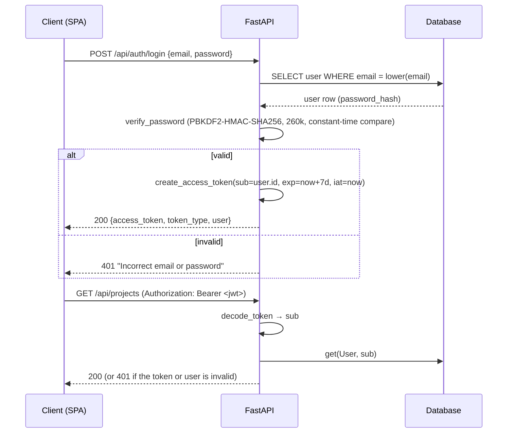

# Security

> Verified against `backend/app/core/security.py`, `core/ratelimit.py`,
> `api/deps.py`, `main.py`, `frontend/nginx.conf` and the deployment manifests.
> Controls are marked **Implemented**, **Partial** or **Not implemented** based on
> source, never on intent. This application has **not** been penetration-tested,
> threat-modelled by an external reviewer, or audited. Nothing here is a claim of
> security certification.

---

## 1. Authentication architecture



| Property | Implementation |
| --- | --- |
| Sign-in methods | Email + password (`/auth/login`), registration (`/auth/register`), demo token (`/auth/demo`, only when `DEMO_MODE=true`) |
| Third-party identity | none — no OAuth/OIDC/SAML integration exists |
| Multi-factor | not implemented |
| Password policy | length 8–128 only (no complexity, breach-list or reuse checks) |
| Account lockout | not implemented |
| Email verification | not implemented |
| Password reset | not implemented |
| Session transport | `Authorization: Bearer` header |
| Client storage | `localStorage["marketpulse-token"]` |

---

## 2. JWT generation and validation

`backend/app/core/security.py`

```python
_ALGORITHM = "HS256"

def create_access_token(subject, expires_minutes=None):
    payload = {"sub": subject, "exp": now + lifetime, "iat": now}
    return jwt.encode(payload, settings.secret_key, algorithm=_ALGORITHM)

def decode_token(token):
    try:
        return jwt.decode(token, settings.secret_key, algorithms=[_ALGORITHM]).get("sub")
    except jwt.PyJWTError:
        return None
```

| Aspect | Status |
| --- | --- |
| Algorithm | HS256, symmetric, single `SECRET_KEY` |
| Expiry | `ACCESS_TOKEN_EXPIRE_MINUTES`, default 10080 (7 days) — refreshed only by re-authenticating |
| Claims | `sub` (user UUID), `exp`, `iat`. No `aud`, `iss`, `jti`, scope or role claims |
| Validation | Signature + expiry enforced by PyJWT with an explicit algorithm list (no `alg` confusion), then the subject must parse as a UUID and resolve to an existing user |
| Revocation | **Not implemented** — no denylist, no `jti`, no token version column. Rotating `SECRET_KEY` invalidates every token at once |
| Refresh tokens | **Not implemented** — no refresh endpoint; users sign in again after 7 days |
| Transport security | TLS is expected to be terminated in front of the app; nothing in the repository enforces HTTPS |

---

## 3. Password hashing

```
stored = "pbkdf2_sha256$260000$<16-byte salt hex>$<derived key hex>"
```

| Property | Value |
| --- | --- |
| KDF | PBKDF2-HMAC-SHA256 (`hashlib.pbkdf2_hmac`) |
| Iterations | 260,000 (OWASP 2023 guidance for PBKDF2-SHA256) — encoded in the hash so it can be raised later |
| Salt | 16 random bytes per password (`os.urandom`) |
| Comparison | `hmac.compare_digest` on the hex digest (constant-time) |
| Failure mode | malformed stored hash → `False` (never raises to the client) |
| Upgrade path | algorithm/iterations are read from the stored string; rehashing on login is **not** implemented |

Passwords are never logged, never returned by any endpoint and never included in
error messages.

---

## 4. Authorisation and resource ownership

```python
def get_project(project_id, db, user):
    project = db.get(ResearchProject, project_id)
    if project is None or project.user_id != user.id:
        raise HTTPException(404, "Research project not found")
    return project
```

| Rule | Implementation |
| --- | --- |
| Every project route depends on `get_project` | yes — analysis, outputs and operations routers all declare `project: ResearchProject = Depends(get_project)` |
| Foreign project | **404**, not 403, so identifiers cannot be probed for existence |
| List endpoints scope by user | `where(ResearchProject.user_id == user.id)` |
| Nested resources | roadmap items and scenarios are loaded by ID **and** compared with the resolved `project.id` |
| Notifications | filtered by `user_id`; `mark_read` compares `notification.user_id != user.id` |
| Chat history | filtered by `project_id` **and** `user_id` |
| Roles / admin | **Not implemented** — every authenticated user is equal; there is no admin surface, team, organisation or sharing model |
| Object-level checks in services | the services trust the `project` passed in, which is always the dependency-resolved object |

Test coverage: `test_project_isolation_between_users` asserts 404 on project detail
and evidence, and an empty project list, for a second account.

---

## 5. Project-level data isolation

- Tenant boundary = **user**. There is no organisation level, so two colleagues in
  the same company cannot share a project.
- Isolation is enforced in the application layer, not by database row-level security.
  Any future raw-SQL access path must repeat the `user_id` predicate.
- `evidence_records`, `failure_findings`, `opportunity_findings`,
  `strategic_relationships`, `roadmap_items`, `reports`, `chat_messages` and
  `notifications` inherit isolation through their parent project; there is no
  endpoint that queries them without a resolved project (except notifications, which
  filter on `user_id`).
- JSON `evidence_ids` inside findings are UUIDs from the same project by
  construction (the engine only selects records where `project_id == project.id`).

---

## 6. Input validation

| Surface | Control |
| --- | --- |
| Request bodies | Pydantic v2 models with `min_length`/`max_length`, `Literal` enumerations, `EmailStr`, `ge`/`le` bounds; failure → **422** with per-field messages |
| Country codes | allowlist (`COUNTRY_BY_CODE`) — unknown codes rejected |
| Source categories | allowlist (`SOURCE_CATEGORY_KEYS`) — unknown rejected, empty rejected |
| Website | normalised to `https://` and must contain a dot; not fetched, so no SSRF surface |
| Dates | period ordering validated; `date` parsing via Pydantic |
| Enumerations | `depth`, `priority`, `status`, `horizon`, `interval` are `Literal` types |
| Query parameters | typed with bounds (`page ≥ 1`, `page_size ≤ 100`, `limit ≤ 120`, `search ≤ 200`) |
| Free text routed to the LLM | length-capped by schema; wrapped as untrusted data before it reaches the model |
| File uploads | **no upload endpoint exists**; `MAX_UPLOAD_BYTES` is declared but unused |
| Response validation | routes declare `response_model`, so responses are filtered to the schema |

Missing validation worth knowing: `objectives` are not checked against the catalog,
`track` keys in monitoring are not validated against `TRACK_LABELS`, and
`analysis_preferences` is a free-form dict that is stored but not interpreted.

---

## 7. SQL injection prevention

- All database access goes through the SQLAlchemy 2 ORM/Core with bound parameters
  (`select(Model).where(Model.col == value)`); no `text()` with interpolated user
  input exists anywhere in `app/`.
- The only raw SQL is `text("SELECT 1")` in the health check.
- `ilike(f"%{q}%")` is used for project search, but `q` is a **bound parameter**
  value — the pattern is data, not SQL. `%`/`_` inside the term act as wildcards in
  the value, which is an information-retrieval nuance, not injection.
- ORM cascade and relationship loading prevent hand-written JOIN strings.

---

## 8. CORS

```python
allow_origins=settings.cors_origin_list,      # comma-separated env, no wildcard by default
allow_credentials=True,
allow_methods=["GET", "POST", "PATCH", "DELETE", "OPTIONS"],
allow_headers=["Authorization", "Content-Type", "Accept"],
```

- Default list: `http://localhost:5173,http://localhost:8080` (Compose adds explicit
  origins; `.env.example` lists three localhost ports).
- `allow_origins=["*"]` is **not** configured, and would be incompatible with
  `allow_credentials=True` anyway.
- In the Compose stack the browser talks to nginx on the same origin and `/api` is
  proxied, so CORS is not in the request path there — it exists for the Vite
  development origin and split deployments.
- `expose_headers` is not configured, so clients cannot read `x-request-id`
  cross-origin.

---

## 9. Rate limiting

`backend/app/core/ratelimit.py` — a sliding window (3600 s) held in a
`defaultdict(deque)` guarded by a lock.

| Property | Status |
| --- | --- |
| Scope | per `(scope, user_id)`; scopes are `research-run`, `simulator`, `assistant`, `report`, `suggest-competitors` |
| Cost weighting | run = 3, simulate = 2, compare = number of scenarios, chat/report/suggest = 1 |
| Response | **429** with a human-readable retry hint |
| Storage | process memory — **not** shared across workers, reset on restart, unbounded growth per distinct user |
| Coverage | only AI-cost endpoints. `/auth/login`, `/auth/register` and `/auth/demo` are **not** rate limited |
| Distributed option | not implemented (Redis is available in Compose but unused for limiting) |

Consequence: an attacker with many accounts or a restart can bypass the AI budget, and
credential-guessing is limited only by network latency. Listed in §15.

---

## 10. Secret management

| Secret | Handling |
| --- | --- |
| `SECRET_KEY` | environment only; default value is an explicit placeholder (`dev-insecure-secret-change-me-please-0123456789`) and Compose defaults to `change-me-…` |
| `GEMINI_API_KEY`, `TAVILY_API_KEY`, `BRAVE_API_KEY` | environment only; used server-side; never returned by an endpoint, never embedded in the frontend bundle (Vite only exposes `VITE_*`) |
| `POSTGRES_PASSWORD` | Compose variable with a weak development default |
| `DATABASE_URL` | environment; contains credentials, never logged (SQLAlchemy engine logging is pinned to `WARNING`) |
| `.env` | git-ignored |
| Logs | JSON formatter emits `ts, level, logger, request_id, message, event, project_id, user_id, stage, duration_ms` — no headers, no tokens, no passwords, no prompt bodies |
| Frontend | only `VITE_API_BASE_URL` is compiled in; no key material exists client-side |
| Demo credentials | intentionally exposed by `GET /api/meta/capabilities` **only** when `DEMO_MODE=true` |

**Action required by the operator (not a code fix):** if
`TAVILY_API_KEY`/`GEMINI_API_KEY` have ever been committed or shared in a template
file, rotate them at the provider. This documentation pass removed live-looking key
values from `.env.example`; rotation is still required because git history may retain
them.

---

## 11. External API security

| Integration | Direction | Controls | Gaps |
| --- | --- | --- | --- |
| Tavily / Brave | outbound HTTPS | key from environment, request timeout (`SEARCH_TIMEOUT_SECONDS`, 25 s), no redirects configured, response parsed with `.json()` | no retry/backoff, no response size cap, no allow-list of domains |
| Gemini | outbound HTTPS | key from environment, timeout (`LLM_TIMEOUT_SECONDS`, 60 s), 2 attempts on 429/5xx, response must parse as JSON | key passed as a **query parameter** (appears in provider access logs); no egress allow-list |
| PostgreSQL | internal | credentials in URL, pool limits | no TLS enforcement (`sslmode`) for managed databases |
| Browser → API | inbound | bearer token, CORS allowlist | token in `localStorage` (XSS-reachable) |

No inbound webhooks, no open proxies, and no user-supplied URLs are fetched — so the
SSRF surface is effectively nil today (this changes if page fetching is added).

---

## 12. Prompt injection considerations

Untrusted text (search snippets, review bodies) reaches the model through
`untrusted_block()`:

- content is stripped of the `<<<` / `>>>` delimiters so a record cannot close the
  wrapper early;
- each block is labelled with its own metadata and truncated (600–900 chars in
  grounding paths);
- the system instruction states that source data is evidence only and that embedded
  instructions must not be followed;
- outputs are parsed as JSON and only known keys are read.

Residual risk: there is no output-side detector, no allow-list of domains, and no
provenance check on cited indices. A successful injection can influence *wording* of a
summary or answer, but cannot change stored metrics, severity, counts or the citation
list — all of which are produced before the call. See
[`AI_ENGINEERING.md`](AI_ENGINEERING.md) §8.

---

## 13. Error handling and information exposure

| Case | Client sees | Server does |
| --- | --- | --- |
| Validation error | field + message per invalid field | Pydantic detail mapped, no stack |
| Auth failure | `{"detail": "Incorrect email or password"}` — does not reveal whether the account exists | nothing logged beyond the request line |
| Foreign/unknown project | uniform 404 | nothing |
| Rate limit | 429 with the configured limit | nothing |
| Unhandled exception | generic message + `request_id` | full stack trace in JSON logs |
| LLM failure | deterministic output, or 502 for suggestions | warning log with the provider error |
| Health check failure | `status: degraded` | no exception text |

Two deliberate exceptions to "nothing sensitive": `GET /meta/capabilities` exposes
provider *configuration state* (booleans, provider names, limitation strings) and demo
credentials when demo mode is on. Both are intentional and safe by design; neither
exposes a key.

Response headers: API adds `x-content-type-options: nosniff` and
`referrer-policy: strict-origin-when-cross-origin`; nginx adds `X-Frame-Options:
SAMEORIGIN` plus the same two. **No** Content-Security-Policy, HSTS or
Permissions-Policy is set.

---

## 14. Logging considerations

- Structured JSON on stdout, one line per event, `request_id` correlated through a
  `ContextVar`.
- Security-relevant events that are logged: unhandled exceptions, stage failures,
  research job crashes, LLM failures, Celery dispatch failures.
- Events that are **not** logged: successful sign-in, failed sign-in, registration,
  token validation failure, rate-limit rejection, project deletion. There is no audit
  trail for access to another user's data (it 404s silently).
- No log rotation or retention configuration exists; collection is delegated to the
  platform's log driver.

---

## 15. Threat model

| Threat | Attack surface | Mitigation | Status |
| --- | --- | --- | --- |
| Credential stuffing / password guessing | `POST /auth/login`, `/auth/register` | PBKDF2 at 260k iterations slows offline cracking; generic error message avoids account enumeration | **Partial** — no lockout, no throttling, no CAPTCHA, no breach-list check |
| Weak operator secret | `SECRET_KEY` default | Documented as insecure; Compose passes it through env; deployment checklist requires rotation | **Partial** — no startup refusal to run with the default key |
| Token theft via XSS | `localStorage` token; React app rendering provider text | React escapes rendered strings; no `dangerouslySetInnerHTML` in the app; tokens expire after 7 days | **Partial** — no CSP, no httpOnly cookie option, no revocation |
| Broken access control (IDOR) | `/api/projects/{id}/…`, roadmap/scenario IDs, notifications | `get_project` 404s on foreign IDs; nested rows compared to resolved project; isolation test exists | **Implemented** |
| Cross-user data access through lists | `/projects`, `/dashboard`, `/notifications`, `/monitoring` | every query filters by `user_id` | **Implemented** |
| SQL injection | all endpoints | SQLAlchemy bound parameters; no interpolated SQL | **Implemented** |
| Mass assignment / over-posting | `PATCH /projects`, `PATCH /roadmap/{id}` | explicit Pydantic models with `Literal` fields; `exclude_unset` application | **Implemented** |
| Prompt injection through research content | search snippets → LLM prompts | guarded system instruction, delimiter sanitisation, JSON-only output, deterministic metrics | **Partial** — no output verification |
| Malicious / low-quality external content | search results, demo corpus | credibility labels surfaced; contradictions flagged; findings require multiple records for high severity | **Partial** — no URL validation, no domain allow-list, no moderation |
| Hallucinated citations | assistant, report | citations built from stored rows before generation; assistant refuses without evidence | **Partial** — model text is not checked against the citation set |
| API abuse / cost exhaustion | `/run`, `/chat`, `/simulate`, `/suggest-competitors` | weighted per-user hourly budget → 429 | **Partial** — per-process memory, auth endpoints unmetered |
| Secret exposure in repository | `.env`, templates, git history | `.env` git-ignored; no keys in frontend bundle; template values removed in this pass | **Partial** — operator rotation and history review required |
| Sensitive data in logs | structured logs | fixed field allow-list, no bodies/tokens; SQLAlchemy logging pinned to WARNING | **Implemented** |
| Error-message leakage | all endpoints | generic 500 body + `request_id`; stack traces only server-side | **Implemented** |
| Clickjacking | frontend | nginx `X-Frame-Options: SAMEORIGIN` | **Implemented** (Compose/nginx only — not for a raw Vite dev server or a different static host) |
| MITM / plaintext transport | Compose serves HTTP on `:8080` | documented requirement to terminate TLS in front of nginx | **Not implemented** in the repository |
| Dependency vulnerabilities | `requirements.txt`, `package.json` | versions constrained | **Not implemented** — no `pip-audit`, `npm audit` gate or Dependabot configuration |
| Demo tenant abuse | demo account is public | demo project is synthetic; demo mode can be disabled | **Partial** — the demo account is shared by every visitor by design |
| CSRF | cookie-less bearer auth | no cookies are used for authentication, so classic CSRF does not apply | **Implemented** by design |

---

## 16. Security limitations (explicit)

1. No penetration test, threat-model review or security audit has been performed.
2. No security headers beyond nosniff / referrer-policy / X-Frame-Options; no CSP or
   HSTS.
3. Tokens cannot be revoked individually and live for 7 days.
4. No MFA, password reset, email verification, account lockout or session listing.
5. Rate limiting is in-memory and only covers AI endpoints.
6. CI runs tests only: no dependency scanning, secret scanning or SAST.
7. No audit log of authentication events or administrative actions.
8. The demo account is a shared credential by design and must be disabled for any
   real deployment.
9. `SECRET_KEY` has a working default; the app will start insecurely if the operator
   forgets to change it.
10. External provider TLS is validated by `httpx` defaults, but no certificate
    pinning or egress proxy is configured, and the Gemini key travels in the query
    string.

---

## Related documents

- Auth implementation in architecture context: [`ARCHITECTURE.md`](ARCHITECTURE.md) §5
- Deployment hardening checklist: [`DEPLOYMENT.md`](DEPLOYMENT.md) §7
- LLM guardrails: [`AI_ENGINEERING.md`](AI_ENGINEERING.md) §4, §8
- Security roadmap items: [`LIMITATIONS_AND_ROADMAP.md`](LIMITATIONS_AND_ROADMAP.md) §6
